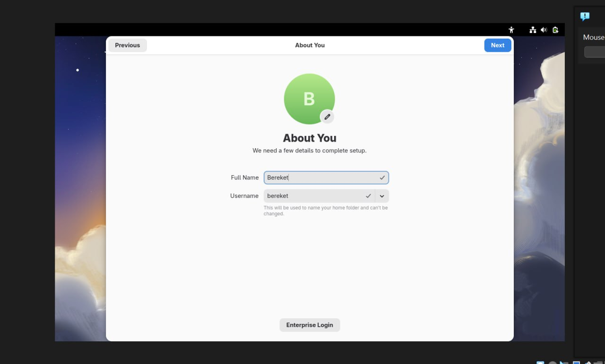

---
## Author
author:
  name: "Кебеде Берекет Дагне"
  email: "1032255864@rudn.ru"
  affiliation:
    - name: "Российский университет дружбы народов"
      country: "Российская Федерация"
      city: "Москва"
## Title
title: "Установка и конфигурация операционной системы"
subtitle: "Лабораторная работа № 1"
date: "2026"
lang: ru-RU
## Presentation output formats
format:
  revealjs:
    theme: serif
    slide-level: 2
    transition: none
  beamer:
    pdf-engine: xelatex
    slide-level: 2
    aspectratio: 169
    section-titles: true
    mainfont: "DejaVu Serif"
    monofont: "DejaVu Sans Mono"
---

# Информация

## Докладчик

:::::::::::::: {.columns align=center}
::: {.column width="70%"}

- **Кебеде Берекет Дагне**
- Российский университет дружбы народов (РУДН)
- [1032255864@rudn.ru](mailto:1032255864@rudn.ru)

:::
::: {.column width="30%"}

**Лабораторная работа № 1**

Установка и конфигурация операционной системы

2026

:::
::::::::::::::

::: notes
- Представить себя и тему лабораторной работы.
:::

# Вводная часть

## Актуальность

- Практическая установка операционной системы в виртуальной машине.
- Знакомство с интерфейсом программы Oracle для Windows 11.
- Настройка пользователя, имени хоста и базовых параметров системы.
- Работа с терминалом Linux после установки.

::: notes
- Кратко обозначить, какие практические навыки были получены.
:::

## Цель и задачи

**Цель:** приобрести практические навыки установки и настройки операционной системы на виртуальной машине.

**Задачи:**

- Ознакомиться с интерфейсом программы Oracle для Windows 11.
- Настроить пользователя и имя хоста.
- Установить дополнительное программное обеспечение через терминал.

::: notes
- Перечислить действия, которые предстоит показать на следующих слайдах.
:::

## Материалы и методы

- Образ операционной системы: **Fedora Workstation 43 (ARM64)**.
- Среда виртуализации: **Oracle**.
- Оперативная память: **4 ГБ**.
- Дисковое пространство: **64 ГБ**.
- Процессор: **AMD RYZEN (Virtualization)**.

::: notes
- Назвать параметры виртуальной машины, указанные в исходной презентации.
:::

# Выполнение работы

## Подготовка виртуальной машины

- Использован образ Fedora Workstation 43 (ARM64).
- Создана виртуальная машина в Oracle.
- Выделены ресурсы:
    - 4 ГБ оперативной памяти;
    - 64 ГБ дискового пространства;
    - процессор AMD RYZEN (Virtualization).

::: notes
- Объяснить основные параметры виртуальной машины.
:::

## Скриншот: настройка виртуальной машины

{width=78%}

::: notes
- Показать параметры виртуальной машины на скриншоте.
:::

## Установка операционной системы

1. Разметка диска с использованием Virtio.
2. Создание учётной записи пользователя `bereket`.
3. Настройка сетевого соединения и имени хоста.
4. Завершение установки и первый запуск системы.

::: notes
- Кратко пройти по этапам установки Fedora.
:::

## Скриншот: выбор диска

{width=78%}

::: notes
- Показать выбор диска для установки операционной системы.
:::

## Скриншот: создание пользователя

{width=78%}

::: notes
- Показать экран создания пользователя во время установки.
:::

## Установка дополнительного ПО

После установки системы установлены пакеты:

```bash
sudo dnf install -y tmux mc kitty pandoc texlive-scheme-full
```

::: notes
- Показать команду установки дополнительного программного обеспечения.
:::

## Скриншот: установка программного обеспечения

{width=78%}

::: notes
- Продемонстрировать результат установки пакетов.
:::

## Сбор сведений о системе

Системные сведения получены с помощью `dmesg`:

- **Ядро:** `6.17.1-300.fc43.aarch64`.
- **Процессор:** `Detected on CPU0`.
- **Память:** около 4 ГБ доступно.

::: notes
- Озвучить информацию, указанную в исходном Markdown-файле.
:::

## Скриншот: диагностика системы

{width=78%}

::: notes
- Показать вывод системных диагностических команд.
:::

# Результаты

## Полученные результаты

- Установлена и настроена операционная система **Fedora**.
- Выполнены базовые настройки пользователя, имени хоста и сети.
- Установлено дополнительное программное обеспечение.
- Получены практические навыки работы с терминалом Linux и `dmesg`.

::: notes
- Суммировать этапы, выполненные в ходе лабораторной работы.
:::

# Заключение

## Главный вывод

В результате выполнения лабораторной работы операционная система Fedora была установлена и настроена. Получены навыки работы с гипервизором Oracle и командной строкой Linux. Система готова к дальнейшей эксплуатации.

::: notes
- Подвести итог выполненной работы.
:::
