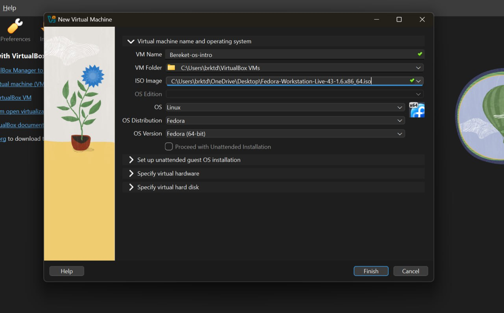
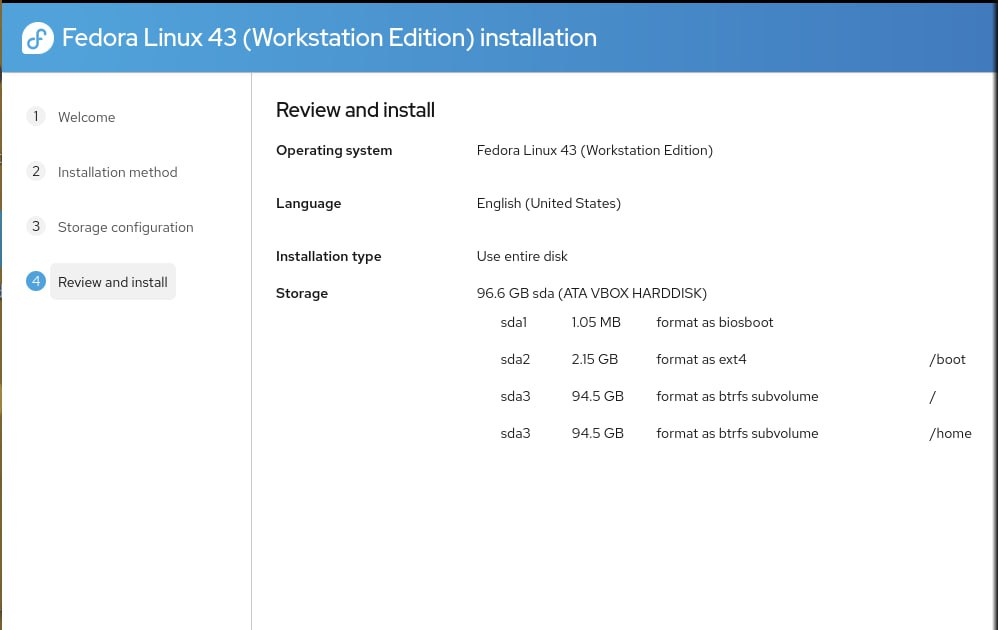
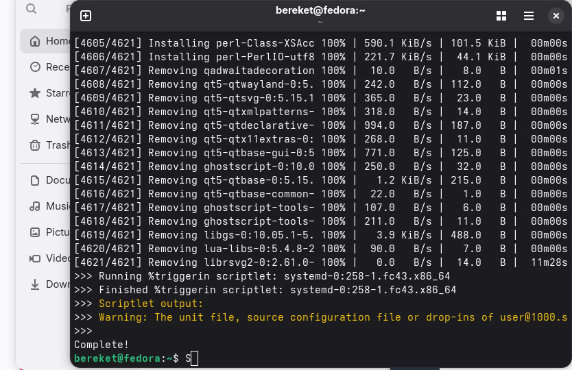
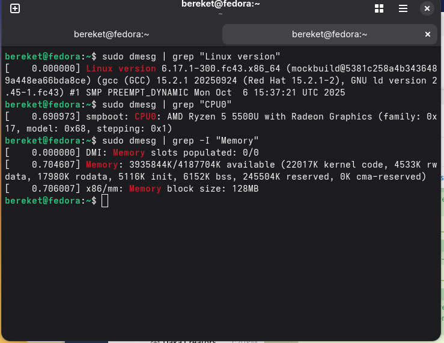

---
## Author
author:
  name: "Кебеде Берекет Дагне"
  email: 1032255864@rudn.ru
  affiliation:
    - name: Российский университет дружбы народов
      country: Российская Федерация
      postal-code: 117198
      city: Москва
      address: ул. Миклухо-Маклая, д. 6

## Title
title: "Лабораторная работа № 1"
subtitle: "Установка и конфигурация операционной системы"
lang: ru
mainfont: "DejaVu Serif"
monofont: "DejaVu Sans Mono"
pdf-engine: xelatex
abstract: |
  В отчёте описаны установка Fedora Workstation на виртуальную машину,
  базовая настройка операционной системы и сбор сведений о ядре,
  процессоре и оперативной памяти. Приведены этапы выполнения работы,
  ссылки на скриншоты и вывод команд диагностики из исходного отчёта.
keywords: [лабораторная работа, Fedora, Linux, виртуальная машина, dmesg]
---

# Введение

## Актуальность

Установка операционной системы в виртуальной машине позволяет освоить
основные этапы подготовки рабочей среды. Последующая настройка системы
и использование консольных команд необходимы для выполнения практических
работ по курсу «Операционные системы».

## Цель работы

Целью данной работы является приобретение практических навыков установки
операционной системы на виртуальную машину, а также навыков работы
с консолью и базовой настройки системы.

## Задачи

В исходном отчёте сформулированы следующие задания:

1. Создать виртуальную машину (в формулировке задания указано «orcal»;
   тип процессора не указан).
2. Установить операционную систему Fedora Workstation.
3. Произвести базовую настройку: имя пользователя `bereket`.
4. Установить дополнительные программные пакеты и собрать информацию
   о системе.

## Объект и предмет исследования

Объект исследования — операционная система Fedora Workstation,
установленная в виртуальной среде. Предмет исследования — установка,
первичная настройка системы и получение технических характеристик
из сообщений ядра Linux.

## Методы исследования

Практическая установка операционной системы в виртуальной машине,
настройка пользовательской среды, установка дополнительных программ
и анализ сообщений ядра с помощью команды `dmesg`.

## Схема выполнения работы

На @fig-flowchart показана последовательность действий, описанных
в исходном отчёте.

::: {#fig-flowchart}

```{mermaid}
%%| fig-width: 100%
graph TD
    A([Начало]) --> B[Создать виртуальную машину]
    B --> C[Установить Fedora Workstation]
    C --> D[Настроить учётную запись]
    D --> E[Обновить систему и установить инструменты]
    E --> F[Получить системные сведения через dmesg]
    F --> G[Оформить результаты и выводы]
    G --> H([Конец])
```

Блок-схема выполнения лабораторной работы № 1

:::

# Теоретическая часть

Виртуальная машина предоставляет изолированную среду для установки
и проверки операционной системы. После установки Fedora можно
выполнять команды в терминале, устанавливать программы и получать
сведения о конфигурации оборудования, видимой операционной системе.

В @tbl-commands приведены использованные в исходном отчёте команды
диагностики.

| Команда | Назначение |
|---|---|
| `sudo dmesg \| grep "Linux version"` | Поиск сведений о версии ядра Linux |
| `sudo dmesg \| grep "CPU0"` | Поиск сообщения о процессоре |
| `sudo dmesg \| grep -I "Memory"` | Команда поиска сведений о памяти, приведённая в исходном отчёте |

: Команды сбора технических сведений {#tbl-commands}

# Материалы и методы

Согласно исходному отчёту, для выполнения работы использовались:

- виртуальная машина с заявленными параметрами 8 ГБ оперативной памяти
  и 64 ГБ дискового пространства;
- операционная система Fedora Workstation;
- виртуальный диск Virtio;
- дополнительные инструменты `tmux`, `mc`, `kitty`, `pandoc`, `texlive`;
- терминал и команда `dmesg` с использованием `sudo`.

В тексте источника упоминаются разные среды виртуализации; это
несоответствие отдельно отмечено в обсуждении результатов.

# Выполнение лабораторной работы

## 1. Создание виртуальной машины

В исходном описании указано, что виртуальная машина была создана
в программе UTM с названием `khadir_os_intro`. Для неё были
заданы 8 ГБ оперативной памяти и 64 ГБ дискового пространства.
На @fig-vm-setup приведён скриншот настройки виртуальной машины.

{#fig-vm-setup width=70%}

## 2. Установка Fedora Workstation

При установке был выбран виртуальный диск Virtio (@fig-disk).
В исходном описании установки указаны полное имя пользователя
`Khadir` и логин `khadir` (@fig-user); в формулировке задания,
напротив, указан логин `bereket`.

{#fig-disk width=70%}

{#fig-user width=70%}

## 3. Настройка после установки

После установки в исходном отчёте отмечены обновление системы
и установка инструментов `tmux`, `mc`, `kitty`, `pandoc` и `texlive`.
Результат этого этапа представлен на @fig-install.

{#fig-install width=70%}

## 4. Сбор данных о системе

Для получения сведений о системе использовались команды `dmesg`
с правами `sudo`. На @fig-dmesg показан вывод системной диагностики.

{#fig-dmesg width=70%}

В исходном отчёте зафиксированы сведения о версии ядра,
процессоре и доступной памяти. Полные строки вывода приведены
в приложении А.

# Результаты

В @tbl-results сведены технические показатели из исходного отчёта.

| Показатель | Значение из исходного отчёта |
|---|---|
| Версия ядра | `6.17.1-300.fc43.x86_64` |
| Процессор | `AMD Ryzen 5 5500U with Radeon Graphics` |
| Доступная память по сообщению ядра | `3935844K/4187704K available` |
| Объём памяти при настройке ВМ (в описании) | 8 ГБ |
| Дисковое пространство при настройке ВМ (в описании) | 64 ГБ |
| Дополнительные инструменты | `tmux`, `mc`, `kitty`, `pandoc`, `texlive` |

: Основные результаты выполнения лабораторной работы {#tbl-results}

В исходном материале приведены пять скриншотов, соответствующих
настройке виртуальной машины, выбору диска, созданию учётной записи,
установке программ и получению системных сведений
(@fig-vm-setup, @fig-disk, @fig-user, @fig-install, @fig-dmesg).

# Обсуждение результатов

В отчёте представлены основные этапы установки и настройки Fedora,
а также диагностика сведений о системе через сообщения ядра.
Данные `dmesg` позволяют зафиксировать версию ядра, обозначение
процессора и сведения о памяти.

**Замечания к исходным данным, требующие проверки по скриншотам:**

- В задании упоминается «orcal», в описании установки — UTM,
  а в исходном заключении — Oracle.
- Для учётной записи в задании указан `bereket`, а в описании
  установки — `Khadir` / `khadir`.
- В исходном заключении заявлена архитектура ARM64, но строка версии
  ядра содержит `x86_64`.
- В тексте настройки указаны 8 ГБ оперативной памяти, тогда как
  зафиксированная строка ядра сообщает около 4 ГБ общей памяти.

Эти различия сохранены как особенности предоставленного материала;
они не разрешены без дополнительных подтверждений.

# Заключение

В исходном отчёте указано, что Fedora 43 установлена, проведена
настройка системы и получены технические сведения с помощью команд
`sudo dmesg`. В ходе выполнения работы были закреплены навыки
работы с консолью, правами `sudo` и сообщениями ядра Linux.

Цель работы — приобретение навыков установки и базовой настройки
операционной системы в виртуальной машине — отражена в представленных
этапах. Отмеченные выше расхождения в параметрах установки
и архитектуре требуют уточнения перед окончательной сдачей отчёта.

# Список литературы {.unnumbered}

::: {#refs}
:::

\appendix

# Приложение А. Вывод команд системной диагностики {.appendix}

Ниже воспроизведены команды и строки вывода из исходного отчёта
без изменения технических значений.

## Версия ядра

```text
bereket@fedora:~$ sudo dmesg | grep "Linux version"
[    0.000000] Linux version 6.17.1-300.fc43.x86_64 (mockbuild@5381c258a4b3436489a448ea66bda8ce) (gcc (GCC) 15.2.1 20250924 (Red Hat 15.2.1-2), GNU ld version 2.45-1.fc43) #1 SMP PREEMPT_DYNAMIC Mon Oct  6 15:37:21 UTC 2025
```

## Информация о процессоре

```text
bereket@fedora:~$ sudo dmesg | grep "CPU0"
[    0.690973] smpboot: CPU0: AMD Ryzen 5 5500U with Radeon Graphics (family: 0x17, model: 0x68, stepping: 0x1)
```

## Информация о памяти

```text
bereket@fedora:~$ sudo dmesg | grep -I "Memory"
[    0.000000] DMI: Memory slots populated: 0/0
[    0.704607] Memory: 3935844K/4187704K available (22017K kernel code, 4533K rwdata, 17980K rodata, 5116K init, 6152K bss, 245504K reserved, 0K cma-reserved)
[    0.706007] x86/mm: Memory block size: 128MB
```
