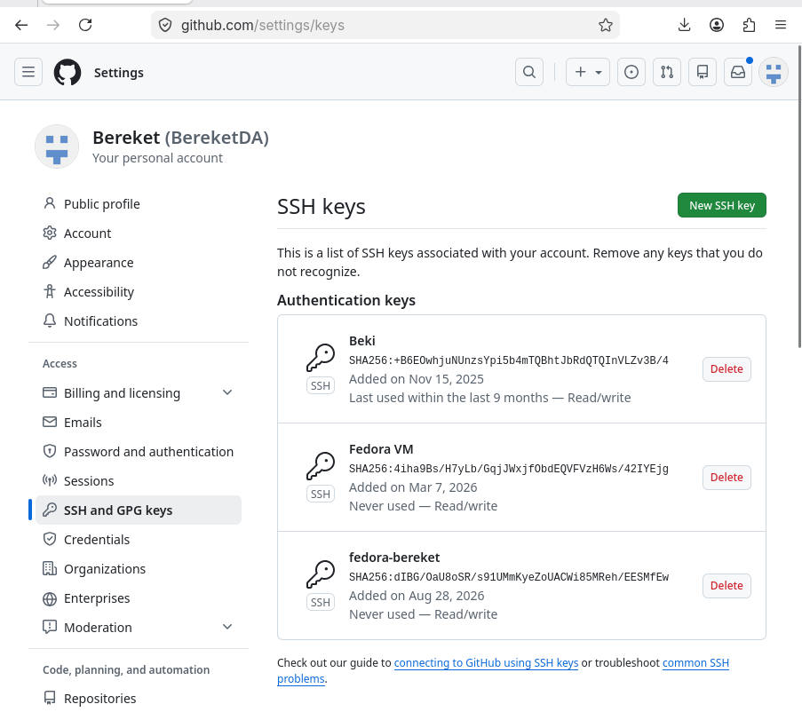
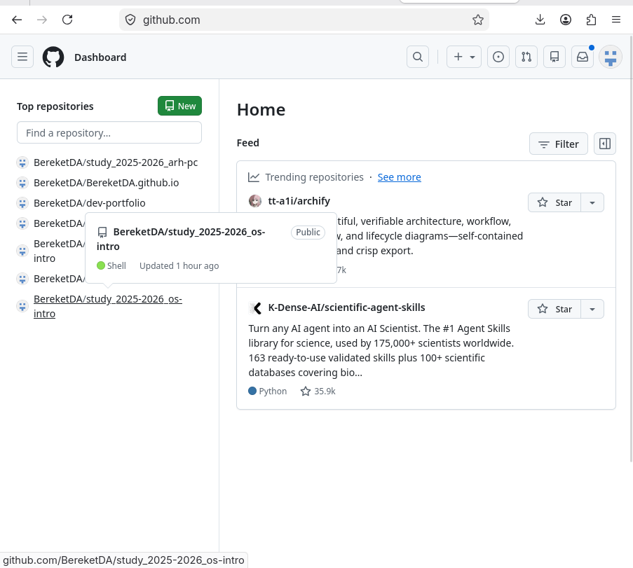

---
## Author
author:
  name: "Кебеде Берекет Дагне"
  email: 1032255864@rudn.ru
  affiliation:
    - name: Российский университет дружбы народов
      country: Российская Федерация
      postal-code: 117198
      city: Москва
      address: ул. Миклухо-Маклая, д. 6

## Title
title: "Лабораторная работа № 2"
subtitle: "Настройка Git"
lang: ru
mainfont: "DejaVu Serif"
monofont: "DejaVu Sans Mono"
pdf-engine: xelatex
abstract: |
  В отчёте представлены результаты лабораторной работы № 2,
  посвящённой изучению системы контроля версий Git и настройке рабочего
  пространства. Описаны установка необходимого программного обеспечения,
  настройка Git, создание SSH- и PGP-ключей, настройка подписи коммитов
  и создание репозитория курса на основе шаблона.
keywords: [лабораторная работа, Git, GitHub, SSH, PGP, контроль версий]
---

# Введение

## Актуальность

Система контроля версий Git позволяет сохранять историю изменений
файлов и организовывать работу с репозиториями. Настройка Git,
подключения к GitHub и подписи коммитов необходима для работы
с материалами курса «Операционные системы».

## Цель работы

Изучить систему контроля версий Git и настроить рабочее пространство
для выполнения лабораторных работ.

## Задачи

- Установить Git, GitHub CLI (`gh`) и Make.
- Выполнить базовую настройку Git.
- Создать SSH-ключи и добавить ключ на GitHub.
- Создать PGP-ключ и добавить его на GitHub.
- Настроить автоматическую подпись коммитов.
- Создать репозиторий курса на основе шаблона и отправить изменения.

## Объект и предмет исследования

Объект исследования — система контроля версий Git и рабочая среда
для выполнения лабораторных работ. Предмет исследования — настройка
Git, SSH- и PGP-ключей, работа с GitHub и подготовка репозитория курса.

## Методы исследования

Практическое выполнение команд в терминале Linux, настройка Git,
использование GitHub CLI для создания репозитория и Git для сохранения
и публикации изменений.

## Схема выполнения работы

На @fig-flowchart представлена последовательность действий,
описанных в исходном отчёте.

::: {#fig-flowchart}

```{mermaid}
%%| fig-width: 100%
graph TD
    A([Начало]) --> B[Установить Git, gh и Make]
    B --> C[Настроить Git]
    C --> D[Создать SSH-ключи]
    D --> E[Добавить SSH-ключ на GitHub]
    E --> F[Создать PGP-ключ]
    F --> G[Добавить PGP-ключ на GitHub]
    G --> H[Настроить подпись коммитов]
    H --> I[Создать репозиторий курса]
    I --> J([Конец])
```

Блок-схема выполнения лабораторной работы № 2

:::

# Теоретическая часть

Система контроля версий (VCS) применяется для отслеживания изменений
в файлах, сохранения истории и совместной работы над проектами.
Git относится к децентрализованным системам контроля версий:
пользователь имеет локальную копию репозитория.

В @tbl-git-tools приведены основные инструменты и команды,
использованные при выполнении лабораторной работы.

| Инструмент или команда | Назначение |
|-----------------------|------------|
| `dnf` | Установка Git, GitHub CLI и Make |
| `git config` | Настройка параметров Git |
| `ssh-keygen` | Создание SSH-ключей |
| `gpg --full-generate-key` | Создание PGP-ключа |
| `gh repo create` | Создание репозитория курса на GitHub |
| `git clone` | Клонирование репозитория |
| `git add` | Добавление изменений к следующему коммиту |
| `git commit` | Фиксация изменений |
| `git push` | Отправка изменений в удалённый репозиторий |

: Инструменты и команды, использованные в лабораторной работе {#tbl-git-tools}

# Материалы и методы

В работе использовались терминал Linux, пакетный менеджер `dnf`,
Git, GitHub CLI (`gh`), Make, утилиты `ssh-keygen` и `gpg`,
а также репозиторий курса, созданный из шаблона GitHub.
Действия выполнялись последовательно и документировались скриншотами.

# Выполнение лабораторной работы

## 1. Установка программного обеспечения

Были установлены Git, GitHub CLI (`gh`) и Make:

```bash
sudo dnf install git gh make -y
```

## 2. Базовая настройка Git

Была выполнена базовая настройка Git:

```bash
git config --global user.name "Bereket Dagne"
git config --global user.email "1032255864@rudn.ru"
git config --global core.quotepath false
git config --global init.defaultBranch master
git config --global core.autocrlf input
git config --global core.safecrlf warn
```

## 3. Создание SSH-ключей

Были созданы SSH-ключи для безопасного подключения к GitHub:

```bash
ssh-keygen -t rsa -b 4096
ssh-keygen -t ed25519
```

Скриншот создания SSH-ключей указан на @fig-ssh-keygen.

## 4. Добавление SSH-ключа на GitHub

SSH-ключ был добавлен в учётную запись GitHub.
Соответствующий скриншот указан на @fig-ssh-github.

## 5. Создание PGP-ключа

Был создан PGP-ключ для подписи коммитов:

```bash
gpg --full-generate-key
```

Скриншот создания PGP-ключа указан на @fig-pgp-create.

## 6. Добавление PGP-ключа на GitHub

PGP-ключ был добавлен в учётную запись GitHub.
Соответствующий скриншот указан на @fig-pgp-github.

## 7. Настройка автоматической подписи коммитов

```bash
git config --global user.signingkey 9E692067E5AE35381B4AE01D7895ED926D4FA4D2
git config --global commit.gpgsign true
git config --global gpg.program $(which gpg2)
```

## 8. Создание репозитория курса

```bash
mkdir -p ~/work/study/2025-2026/Операционные\ системы
cd ~/work/study/2025-2026/Операционные\ системы
gh repo create study_2025-2026_os-intro --template=yamadharma/course-directory-student-template --public
git clone --recursive git@github.com:BereketDA/study_2025-2026_os-intro.git os-intro
cd os-intro
rm package.json
echo os-intro > COURSE
make
git add .
git commit -am 'feat(main): make course structure'
git push
```

Скриншот репозитория на GitHub указан на @fig-repo-github.

# Результаты

В исходном отчёте приведены пять скриншотов с результатами настройки.

На @fig-ssh-keygen показано создание SSH-ключей.

{#fig-ssh-keygen width=70%}

На @fig-ssh-github показан SSH-ключ на GitHub.

{#fig-ssh-github width=70%}

На @fig-pgp-create показано создание PGP-ключа.

{#fig-pgp-create width=70%}

На @fig-pgp-github показан PGP-ключ на GitHub.

{#fig-pgp-github width=70%}

На @fig-repo-github показан репозиторий курса на GitHub.

{#fig-repo-github width=70%}

# Обсуждение результатов

В ходе выполнения работы были установлены Git, GitHub CLI и Make,
выполнена базовая настройка Git, созданы SSH- и PGP-ключи и добавлены
в GitHub. Настроена автоматическая подпись коммитов и создан
репозиторий курса на основе шаблона. Это соответствует поставленной
цели настройки рабочего пространства для лабораторных работ.

## Ответы на контрольные вопросы

**1. Что такое системы контроля версий (VCS) и для решения каких задач они предназначаются?**

Системы контроля версий — это программные инструменты, которые позволяют
отслеживать изменения в файлах, сохранять историю изменений, работать
над проектом в команде, возвращаться к предыдущим версиям и разрешать конфликты.

**2. Объясните понятия VCS: хранилище, commit, история, рабочая копия.**

- **Хранилище (repository)** — это база данных, содержащая все версии файлов и историю изменений.
- **Commit** — это сохранение текущего состояния файлов с описанием изменений.
- **История** — это последовательность всех коммитов, позволяющая отследить изменения.
- **Рабочая копия** — это локальная версия файлов, с которой работает пользователь.

**3. Чем отличаются централизованные и децентрализованные VCS?**

Централизованные VCS имеют единый сервер с репозиторием (например, Subversion).
Децентрализованные VCS (например, Git) позволяют каждому пользователю
иметь полную копию репозитория локально.

**4. Опишите действия с VCS при единоличной работе с хранилищем.**

При единоличной работе создаётся локальный репозиторий, выполняются коммиты,
создаются ветки и фиксируются изменения без необходимости синхронизации
с удалённым репозиторием.

**5. Опишите порядок работы с общим хранилищем VCS.**

Сначала выполняется `git pull` для получения актуальных изменений,
затем вносятся изменения, выполняются `git add`, `git commit` и `git push`
для отправки изменений в общее хранилище.

**6. Каковы основные задачи git?**

Git предназначен для отслеживания изменений в файлах, управления версиями,
совместной работы, создания веток и слияния изменений.

**7. Назовите основные команды git.**

Основные команды: `git init`, `git add`, `git commit`, `git status`,
`git diff`, `git log`, `git branch`, `git checkout`, `git merge`,
`git pull`, `git push`, `git clone`.

**8. Приведите примеры использования локального и удалённого репозиториев.**

Локальный: `git init` — создание репозитория, `git add .` — добавление файлов,
`git commit -m "message"` — сохранение.

Удалённый: `git clone` — копирование репозитория, `git push` — отправка
изменений, `git pull` — получение обновлений.

**9. Что такое ветки (branches) и зачем они нужны?**

Ветки позволяют разрабатывать функциональность изолированно,
не влияя на основную ветку. Это удобно для экспериментов, разработки
новых функций и работы в команде.

**10. Как и зачем можно игнорировать файлы при commit?**

Можно создать файл `.gitignore` с шаблонами файлов, которые не нужно
добавлять в репозиторий (например, временные файлы, объектные файлы,
конфигурационные файлы с секретами). Это предотвращает загрязнение
репозитория ненужными файлами.

# Заключение

В ходе выполнения лабораторной работы были выполнены следующие задачи:

- Установлены Git, GitHub CLI и Make.
- Выполнена базовая настройка Git.
- Созданы SSH-ключи и добавлены на GitHub.
- Созданы PGP-ключи и добавлены на GitHub.
- Настроена автоматическая подпись коммитов.
- Создан репозиторий для курса на основе шаблона.

Таким образом, рабочее пространство для выполнения лабораторных работ
по курсу «Операционные системы» полностью настроено.

# Список литературы {.unnumbered}

::: {#refs}
:::

\appendix

# Приложение А. Основные элементы Git и репозитория {.appendix}

- **Репозиторий** — хранилище файлов и истории их изменений.
- **Коммит** — сохранённое состояние файлов с описанием изменений.
- **История** — последовательность коммитов.
- **Рабочая копия** — локальная версия файлов пользователя.
- **Ветка** — отдельная линия разработки.
- **`.gitignore`** — файл шаблонов для исключения файлов из отслеживания.
