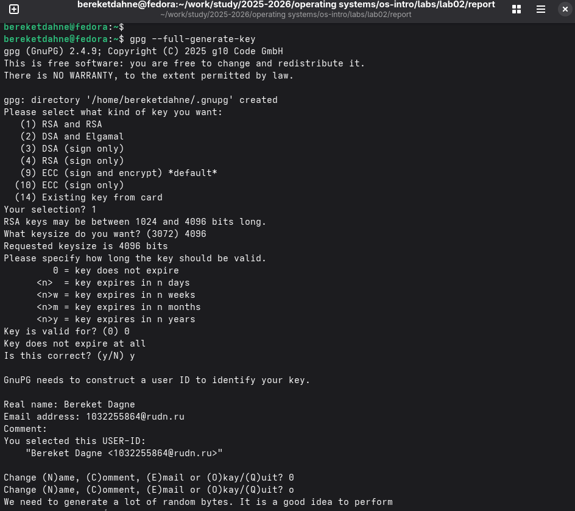
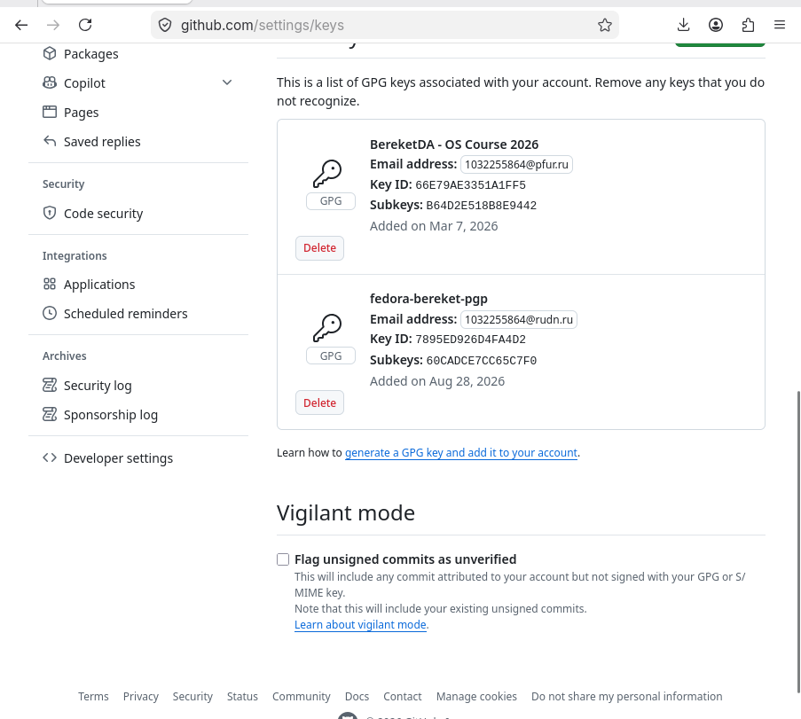

---
## Author
author:
  name: "Кебеде Берекет Дагне"
  email: "1032255864@rudn.ru"
  affiliation:
    - name: "Российский университет дружбы народов"
      country: "Российская Федерация"
      city: "Москва"
## Title
title: "Markdown"
subtitle: "Лабораторная работа № 3"
lang: ru-RU
## Presentation output formats
format:
  revealjs:
    theme: serif
    slide-level: 2
    transition: none
  beamer:
    pdf-engine: xelatex
    slide-level: 2
    aspectratio: 169
    section-titles: true
    mainfont: "DejaVu Serif"
    monofont: "DejaVu Sans Mono"
---

# Информация

## Докладчик

:::::::::::::: {.columns align=center}
::: {.column width="70%"}

- **Кебеде Берекет Дагне**
- Российский университет дружбы народов (РУДН)
- [1032255864@rudn.ru](mailto:1032255864@rudn.ru)

:::
::: {.column width="30%"}

**Лабораторная работа № 3**

Markdown

:::
::::::::::::::

::: notes
- Представиться и назвать тему лабораторной работы.
:::

# Вводная часть

## Актуальность

- Markdown используется для оформления структурированных отчётов.
- Отчёт можно подготовить в исходном текстовом формате.
- Из Markdown можно получить документы в нескольких форматах.

::: notes
- Кратко объяснить, для чего используется Markdown в лабораторной работе.
:::

## Цель и задачи

**Цель:** научиться оформлять отчёты с помощью легковесного языка разметки Markdown.

**Задачи:**

- Подготовить отчёт в формате Markdown.
- Предоставить отчёт в трёх форматах: PDF, DOCX и MD.
- Подготовить архив с исходными материалами.

::: notes
- Назвать цель работы и три задания из исходной презентации.
:::

## Материалы и методы

- **Markdown** — исходный формат отчёта.
- **Makefile** — автоматизация конвертации.
- **PDF, DOCX и MD** — требуемые форматы отчёта.
- **Архив** — исходные материалы работы.

::: notes
- Различать форматы лабораторного отчёта и форматы самой презентации.
:::

# Выполнение работы

## Подготовка отчёта

1. Создана структура каталогов.
2. Подготовлен отчёт в Markdown.
3. Добавлены ответы на вопросы.

::: notes
- Рассказать о первых трёх выполненных шагах.
:::

## Конвертация и архивирование

4. Создан Makefile для автоматической конвертации.
5. Отчёт сконвертирован в PDF и DOCX.
6. Создан архив с исходными материалами.

::: notes
- Объяснить, что сборка и архивирование относятся к отчёту.
:::

# Основные элементы Markdown

## Разметка текста

- Заголовки: `#`, `##`, `###`.
- Полужирное начертание: `**bold**`.
- Курсив: `*italic*`.
- Маркированные списки: `-`.
- Нумерованные списки: `1.`.

::: notes
- Назвать основные средства оформления текста.
:::

## Другие возможности Markdown

- Ссылки и изображения.
- Блоки кода.
- Математические формулы.

::: notes
- Упомянуть дополнительные элементы, перечисленные в исходном файле.
:::

# Иллюстрации из исходных материалов

## Скриншоты предыдущей лабораторной работы

В отчёте по Markdown использованы материалы предыдущей лабораторной работы — настройки Git. Ниже показаны пять скриншотов, хранящихся в каталоге `image/`.

::: notes
- Объяснить, что в лабораторной работе № 3 отчёт оформлялся по материалам предыдущей работы.
- Данные снимки подтверждают содержание исходных материалов, а не отдельные операции форматирования Markdown.
:::

## Создание SSH-ключей

{width=75%}

::: notes
- Показать скриншот генерации SSH-ключей из исходных материалов.
:::

## SSH-ключ на GitHub

{width=75%}

::: notes
- Показать экран GitHub с добавленным SSH-ключом.
:::

## Создание PGP-ключа

{width=75%}

::: notes
- Показать скриншот создания PGP-ключа из исходных материалов.
:::

## PGP-ключ на GitHub

{width=75%}

::: notes
- Показать страницу с PGP-ключом на GitHub.
:::

## Репозиторий на GitHub

{width=75%}

::: notes
- Показать репозиторий, использованный для подготовки исходных материалов к отчёту.
:::

# Результаты

## Итоги работы

- Подготовлен отчёт в формате Markdown.
- Получены форматы PDF и DOCX.
- Создан архив с исходными материалами.
- Пять контрольных вопросов с ответами включены в отчёт.

::: notes
- Подвести итог согласно исходной презентации.
- Сами ответы на вопросы в загруженном файле презентации не приведены.
:::

# Заключение

## Вывод

Markdown — удобный инструмент для создания структурированных документов, которые легко конвертируются в разные форматы.

::: notes
- Озвучить вывод из исходной презентации.
:::

## Спасибо за внимание!

::: notes
- Поблагодарить слушателей и предложить задать вопросы.
:::
