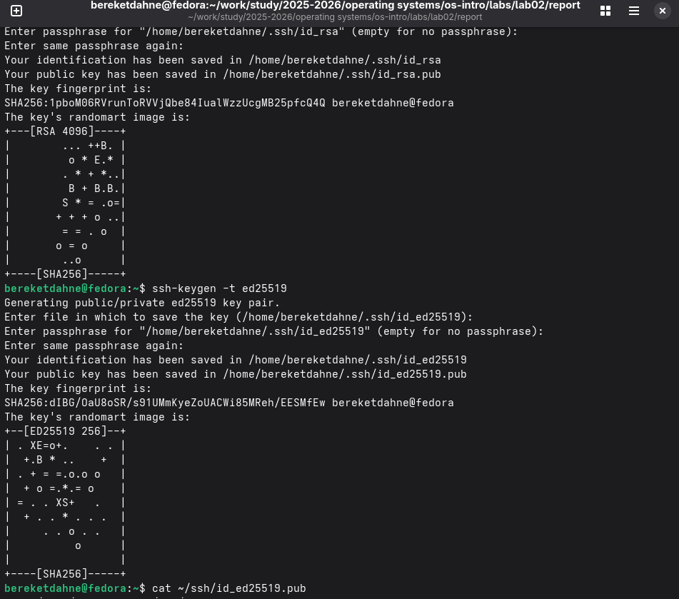

---
## Author
author:
  name: "Кебеде Берекет Дагне"
  email: 1032255864@rudn.ru
  affiliation:
    - name: Российский университет дружбы народов
      country: Российская Федерация
      postal-code: 117198
      city: Москва
      address: ул. Миклухо-Маклая, д. 6

## Title
title: "Лабораторная работа № 3. Markdown"
subtitle: "Настройка Git"
lang: ru
mainfont: "DejaVu Serif"
monofont: "DejaVu Sans Mono"
pdf-engine: xelatex
abstract: |
  В отчёте представлены результаты лабораторной работы № 3,
  посвящённой оформлению отчётов на языке разметки Markdown.
  Рассмотрена подготовка отчёта по предыдущей лабораторной работе,
  преобразование файлов в PDF и DOCX с помощью Pandoc и автоматизация
  преобразования с использованием Makefile. Приведены ответы на контрольные
  вопросы. Материалы по настройке Git из исходного отчёта сохранены в приложении.
keywords: [лабораторная работа, Markdown, Pandoc, Makefile, Git]
---

# Введение

## Актуальность

Markdown — легковесный язык разметки, позволяющий создавать структурированные
документы с простым синтаксисом. Его использование упрощает оформление
лабораторных отчётов и преобразование документов в разные форматы.

## Цель работы

Научиться оформлять отчёты с помощью легковесного языка разметки Markdown.

## Задачи

В соответствии с заданием лабораторной работы необходимо:

- Подготовить отчёт по предыдущей лабораторной работе № 2 в формате Markdown.
- Получить файлы отчёта в трёх форматах: PDF, DOCX и MD.
- Использовать Pandoc для преобразования отчёта в PDF и DOCX.
- Подготовить Makefile для автоматизации преобразования.
- Подготовить архив с исходными материалами, включая скриншоты и Makefile.

## Объект и предмет исследования

Объект исследования — процесс подготовки лабораторного отчёта.
Предмет исследования — возможности Markdown для оформления документа
и средства преобразования файлов в форматы PDF и DOCX.

## Методы исследования

Практическое оформление отчёта в Markdown и использование программы Pandoc
совместно с Makefile для автоматизации преобразования документа.

## Схема выполнения работы

На @fig-flowchart представлена общая последовательность действий,
описанных в отчёте.

::: {#fig-flowchart}

```{mermaid}
%%| fig-width: 100%
graph TD
    A([Начало]) --> B[Подготовить отчёт по лабораторной работе № 2]
    B --> C[Оформить отчёт на Markdown]
    C --> D[Настроить Makefile с Pandoc]
    D --> E[Получить PDF и DOCX]
    E --> F[Подготовить архив исходных материалов]
    F --> G([Конец])
```

Блок-схема выполнения лабораторной работы № 3

:::

# Теоретическая часть

Markdown — язык разметки для создания структурированных документов.
Основные элементы форматирования позволяют записывать заголовки, выделения,
списки, ссылки, изображения и блоки кода в обычном текстовом файле.
Pandoc используется для преобразования таких документов в другие форматы.

В @tbl-markdown приведены основные элементы Markdown, перечисленные
в исходном отчёте.

| Элемент | Синтаксис |
|---------|-----------|
| Заголовок | `# Заголовок` |
| Полужирное начертание | `**bold**` |
| Курсив | `*italic*` |
| Маркированный список | `- пункт` |
| Нумерованный список | `1. пункт` |
| Ссылка | `[text](url)` |
| Изображение | `` |
| Цитата | `>` |
| Блок кода | Три обратные кавычки в начале и конце блока |

: Основные элементы форматирования Markdown {#tbl-markdown}

# Материалы и методы

В ходе выполнения работы использовались язык разметки Markdown,
программа Pandoc и Makefile. За основу был взят отчёт по лабораторной
работе № 2. Подготовленные исходные материалы по описанию работы
включали Markdown-файл, скриншоты и Makefile.

# Выполнение лабораторной работы

## 1. Подготовка отчёта в Markdown

Я подготовил отчёт по предыдущей лабораторной работе № 2 в формате Markdown.
Для этого скопировал структуру отчёта и адаптировал её под требования
текущего задания.

## 2. Подготовка преобразования в PDF и DOCX

Для преобразования Markdown-отчёта использовалась программа Pandoc.
В исходном отчёте приведены следующие команды:

```bash
pandoc report.md -o report.pdf
pandoc report.md -o report.docx
```

## 3. Автоматизация с помощью Makefile

Для автоматической конвертации отчёта в форматы PDF и DOCX был создан
Makefile, использующий Pandoc.

## 4. Подготовка исходных материалов

Также был создан архив с исходными материалами, содержащий файл отчёта
в формате Markdown, скриншоты и сам Makefile.

# Результаты

По сведениям исходного отчёта:

- Подготовлен Markdown-отчёт по лабораторной работе № 2.
- Создан Makefile для преобразования отчёта в PDF и DOCX с помощью Pandoc.
- Подготовлен архив исходных материалов с Markdown-файлом, скриншотами
  и Makefile.

Дополнительные записи из исходного файла, относящиеся к настройке Git,
приведены отдельно в приложении А. Пять ссылок на скриншоты из этой части
исходного файла также сохранены.

# Обсуждение результатов

Использование Markdown позволяет отделять содержание отчёта от деталей
форматирования. Pandoc предоставляет способ получать PDF и DOCX из
одного текстового источника. Makefile позволяет автоматизировать
повторяющиеся команды преобразования.

## Ответы на контрольные вопросы

**1. Что такое Markdown и для чего он используется?**

Markdown — это легковесный язык разметки, который используется для создания
структурированных документов с простым синтаксисом. Он позволяет быстро
оформлять тексты, которые легко конвертируются в HTML, PDF, DOCX и другие
форматы.

**2. Какие основные элементы форматирования есть в Markdown?**

Основные элементы: заголовки (`#`), полужирное (`**bold**`) и курсивное
(`*italic*`) начертание, маркированные (`-`) и нумерованные (`1.`)
списки, ссылки (`[text](url)`), изображения (``), цитаты (`>`),
блоки кода и математические формулы.

**3. Как преобразовать Markdown-файл в PDF и DOCX?**

Для преобразования используется программа Pandoc. Команда для создания PDF:
`pandoc report.md -o report.pdf`. Команда для создания DOCX:
`pandoc report.md -o report.docx`.

**4. Какова структура научного отчёта по ГОСТ?**

Согласно ГОСТ 7.32-2001, структура научного отчёта включает:
титульный лист, реферат, введение, основную часть, заключение,
список использованных источников и приложения.

**5. Почему полезно использовать Markdown для лабораторных работ?**

Markdown позволяет быстро создавать структурированные документы,
легко конвертировать их в разные форматы, использовать системы
контроля версий (например, Git) для отслеживания изменений
и сосредоточиться на содержании, а не на форматировании.

# Заключение

В ходе выполнения лабораторной работы № 3 я освоил основы работы с языком
разметки Markdown. Я научился создавать структурированные документы
с использованием заголовков, списков, ссылок, изображений и блоков кода.
Также я освоил процесс конвертации Markdown-файлов в форматы PDF и DOCX
с помощью программы Pandoc и автоматизировал этот процесс
с использованием Makefile.

Таким образом, цель работы — научиться оформлять отчёты с помощью Markdown —
была полностью достигнута. Полученные навыки будут полезны для оформления
последующих лабораторных работ, курсовых и дипломных проектов.

# Список литературы {.unnumbered}

::: {#refs}
:::

\appendix

# Приложение А. Материалы по настройке Git из исходного отчёта {.appendix}

Ниже сохранены материалы о настройке Git, которые содержались
в исходном Markdown-файле после выводов по лабораторной работе № 3.

## 1. Установка программного обеспечения

Были установлены Git, GitHub CLI (`gh`) и Make:

```bash
sudo dnf install git gh make -y
```

## 2. Базовая настройка Git

Была выполнена базовая настройка Git:

```bash
git config --global user.name "Bereket Dagne"
git config --global user.email "1032255864@rudn.ru"
git config --global core.quotepath false
git config --global init.defaultBranch master
git config --global core.autocrlf input
git config --global core.safecrlf warn
```

## 3. Создание SSH-ключей

Были созданы SSH-ключи для безопасного подключения к GitHub:

```bash
ssh-keygen -t rsa -b 4096
ssh-keygen -t ed25519
```

На @fig-ssh-keygen показано создание SSH-ключей.

{#fig-ssh-keygen width=70%}

## 4. Добавление SSH-ключа на GitHub

SSH-ключ был добавлен в учётную запись GitHub.

На @fig-ssh-github показано добавление SSH-ключа на GitHub.

{#fig-ssh-github width=70%}

## 5. Создание PGP-ключа

Был создан PGP-ключ для подписи коммитов:

```bash
gpg --full-generate-key
```

На @fig-pgp-create показано создание PGP-ключа.

{#fig-pgp-create width=70%}

## 6. Добавление PGP-ключа на GitHub

PGP-ключ был добавлен в учётную запись GitHub.

На @fig-pgp-github показано добавление PGP-ключа на GitHub.

{#fig-pgp-github width=70%}

## 7. Настройка автоматической подписи коммитов

```bash
git config --global user.signingkey 9E692067E5AE35381B4AE01D7895ED926D4FA4D2
git config --global commit.gpgsign true
git config --global gpg.program $(which gpg2)
```

## 8. Создание репозитория курса

```bash
mkdir -p ~/work/study/2025-2026/Операционные\ системы
cd ~/work/study/2025-2026/Операционные\ системы
gh repo create study_2025-2026_os-intro --template=yamadharma/course-directory-student-template --public
git clone --recursive git@github.com:BereketDA/study_2025-2026_os-intro.git os-intro
cd os-intro
rm package.json
echo os-intro > COURSE
make
git add .
git commit -am 'feat(main): make course structure'
git push
```

На @fig-repo-github показан репозиторий на GitHub.

{#fig-repo-github width=70%}
