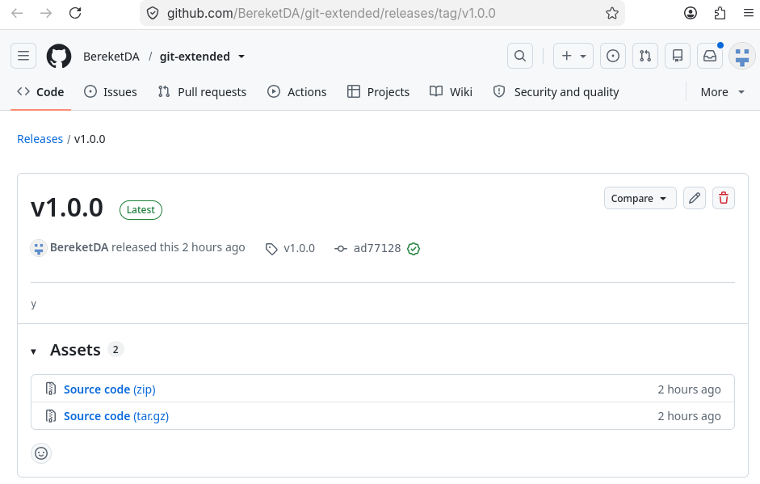

---
## Author
author:
  name: "Кебеде Берекет Дагне"
  email: "1032255864@rudn.ru"
  affiliation:
    - name: "Российский университет дружбы народов"
      country: "Российская Федерация"
      city: "Москва"
## Title
title: "Gitflow и Conventional Commits"
subtitle: "Лабораторная работа № 4"
lang: ru-RU
## Presentation output formats
format:
  revealjs:
    theme: serif
    slide-level: 2
    transition: none
  beamer:
    pdf-engine: xelatex
    slide-level: 2
    aspectratio: 169
    section-titles: true
    mainfont: "DejaVu Serif"
    monofont: "DejaVu Sans Mono"
---

# Информация

## Докладчик

:::::::::::::: {.columns align=center}
::: {.column width="70%"}

- **Кебеде Берекет Дагне**
- Российский университет дружбы народов (РУДН)
- [1032255864@rudn.ru](mailto:1032255864@rudn.ru)

:::
::: {.column width="30%"}

**Лабораторная работа № 4**

Gitflow и Conventional Commits

:::
::::::::::::::

::: notes
- Представиться и назвать тему лабораторной работы.
:::

# Вводная часть

## Актуальность

- Gitflow помогает организовать ветвление репозитория при подготовке релизов.
- Conventional Commits задаёт единый формат сообщений коммитов.
- Эти инструменты применяются для организации совместной работы над проектом.

::: notes
- Кратко объяснить, почему в работе рассматриваются модель ветвления и соглашение о сообщениях коммитов.
:::

## Цель и задачи

**Цель:** получение навыков правильной работы с репозиториями Git.

**Задачи:**

- Инициализировать git-flow и создать репозиторий `git-extended`.
- Настроить commitizen и создать функциональную ветку.
- Подготовить и завершить релиз `1.0.0`.
- Опубликовать релиз на GitHub.

::: notes
- Цель взята из исходной презентации.
- Задачи соответствуют шести выполненным шагам.
:::

## Материалы и методы

- **Git** — система контроля версий.
- **Gitflow** — модель ветвления для релизов.
- **Conventional Commits** — формат сообщений коммитов.
- **commitizen** — настройка сообщений коммитов.
- **GitHub** — публикация релиза.

::: notes
- Перечислить инструменты, указанные в исходном материале.
:::

# Основные понятия

## Модель Gitflow

- `master` — production.
- `develop` — разработка.
- `feature/*` — новые функции.
- `release/*` — подготовка релиза.
- `hotfix/*` — исправления.

::: notes
- Объяснить назначение веток согласно исходной презентации.
:::

## Conventional Commits

Стандарт написания сообщений коммитов:

- `feat` — новая функция.
- `fix` — исправление ошибки.
- `chore` — вспомогательные задачи.
- `docs` — изменения в документации.

::: notes
- Назвать четыре типа коммитов из исходной презентации.
:::

# Выполнение работы

## Подготовка репозитория

1. Инициализирован git-flow.
2. Создан репозиторий `git-extended`.
3. Настроен commitizen.
4. Создана функциональная ветка.

::: notes
- Последовательно описать подготовительные действия.
:::

## Подготовка и публикация релиза

5. Создан и завершён релиз `1.0.0`.
6. Создан релиз на GitHub.

::: notes
- Объяснить завершение работы с релизом.
:::

# Иллюстрации выполнения работы

## Ветки репозитория

{width=75%}

::: notes
- Показать ветки, созданные в ходе выполнения работы.
:::

## Теги репозитория

{width=75%}

::: notes
- Показать тег версии 1.0.0 на скриншоте.
:::

## Релиз на GitHub

{width=75%}

::: notes
- Показать опубликованный релиз на GitHub.
:::

# Результаты

## Итоги работы

- Созданы ветки `master` и `develop`.
- Создан тег `v1.0.0`.
- Создан релиз на GitHub.
- Создан файл `CHANGELOG.md`.

::: notes
- Перечислить результаты, указанные в исходной презентации.
- При демонстрации можно обратиться к скриншотам веток, тегов и релиза.
:::

# Заключение

## Вывод

Gitflow и Conventional Commits помогают организовать работу с Git в команде и управлять релизами.

::: notes
- Озвучить вывод исходной презентации.
:::

## Спасибо за внимание!

::: notes
- Поблагодарить слушателей и предложить задать вопросы.
:::
