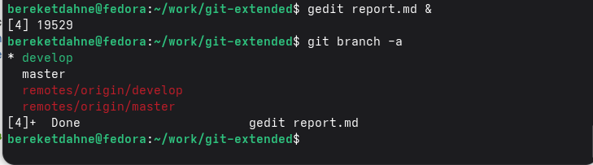
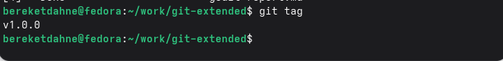

---
## Author
author:
  name: "Кебеде Берекет Дагне"
  email: 1032255864@rudn.ru
  affiliation:
    - name: Российский университет дружбы народов
      country: Российская Федерация
      postal-code: 117198
      city: Москва
      address: ул. Миклухо-Маклая, д. 6

## Title
title: "Лабораторная работа № 4"
subtitle: "Продвинутое использование Git. Gitflow и Conventional Commits"
lang: ru
mainfont: "DejaVu Serif"
monofont: "DejaVu Sans Mono"
pdf-engine: xelatex
abstract: |
  В отчёте представлены результаты выполнения лабораторной работы № 4,
  посвящённой расширенным возможностям Git, модели ветвления Gitflow
  и стандарту Conventional Commits. Рассмотрены создание репозитория,
  работа с функциональной веткой, подготовка релиза 1.0.0,
  генерация CHANGELOG.md и публикация релиза на GitHub.
keywords: [лабораторная работа, Git, Gitflow, Conventional Commits, релиз, GitHub]
---

# Введение

## Актуальность

Использование Git для совместной разработки требует согласованного
ветвления, понятных сообщений коммитов и порядка выпуска версий.
В лабораторной работе рассматриваются модель Gitflow, стандарт
Conventional Commits и инструменты подготовки релизов.

## Цель работы

Получение навыков правильной работы с репозиториями git, использование модели ветвления Gitflow и стандарта Conventional Commits.

## Задачи

1. Установить git-flow, Node.js, pnpm
2. Установить commitizen и standard-changelog
3. Создать репозиторий git-extended
4. Инициализировать git-flow
5. Настроить package.json для commitizen
6. Создать функциональную ветку и добавить файл index.js
7. Завершить функциональную ветку
8. Создать релиз 1.0.0
9. Сгенерировать CHANGELOG.md
10. Опубликовать релиз на GitHub

## Объект и предмет исследования

Объект исследования — репозиторий Git и организация процесса разработки.
Предмет исследования — работа с ветками в модели Gitflow,
оформление коммитов по Conventional Commits и выпуск версий на GitHub.

## Методы исследования

Практическое выполнение команд в терминале Linux, установка инструментов,
настройка репозитория, создание веток и тегов, генерация журнала изменений
и публикация релиза на GitHub.

## Схема выполнения работы

На @fig-flowchart показана последовательность действий лабораторной работы.

::: {#fig-flowchart}

```{mermaid}
%%| fig-width: 100%
graph TD
    A([Начало]) --> B[Установка git-flow, Node.js, pnpm и инструментов]
    B --> C[Создание репозитория git-extended]
    C --> D[Инициализация Gitflow и настройка package.json]
    D --> E[Создание функциональной ветки и index.js]
    E --> F[Завершение функциональной ветки]
    F --> G[Создание релиза 1.0.0 и CHANGELOG.md]
    G --> H[Публикация веток, тегов и релиза на GitHub]
    H --> I([Конец])
```

Блок-схема выполнения лабораторной работы № 4

:::

# Теоретическая часть

Gitflow — модель ветвления для управления разработкой и релизами.
В исходном отчёте перечислены ветки `master`, `develop`, `feature/*`,
`release/*` и `hotfix/*`. Conventional Commits задаёт типы
сообщений коммитов, например `feat`, `fix` и `chore`.
Семантическое версионирование использует три компонента номера версии:
мажорную, минорную и патч.

В @tbl-git-tools приведены инструменты и команды, используемые в работе.

| Инструмент или команда | Назначение |
|-----------------------|------------|
| `git flow init` | Инициализация модели ветвления Gitflow |
| `git flow feature start` | Создание функциональной ветки |
| `git flow feature finish` | Завершение функциональной ветки |
| `git flow release start` | Начало подготовки релиза |
| `standard-changelog` | Генерация журнала изменений |
| `git push --all` | Публикация веток |
| `git push --tags` | Публикация тегов |
| `gh release create` | Создание релиза на GitHub |

: Основные инструменты и команды лабораторной работы {#tbl-git-tools}

# Материалы и методы

Использовались Linux, Git, git-flow, Node.js, pnpm, commitizen,
standard-changelog и GitHub. Практические действия выполнялись
в репозитории `git-extended`. В ходе работы создавались ветки `master`
и `develop`, функциональная ветка и релиз версии `1.0.0`.

# Выполнение лабораторной работы

## 1. Установка программного обеспечения
Были установлены git-flow, Node.js и pnpm:
```bash
sudo dnf copr enable elegos/gitflow
sudo dnf install gitflow -y
sudo dnf install nodejs pnpm -y
pnpm setup
source ~/.bashrc
pnpm add -g commitizen standard-changelog
```

## 2. Создание репозитория
Был создан репозиторий `git-extended` на GitHub и клонирован локально:
```bash
git clone git@github.com:BereketDA/git-extended.git
cd git-extended
```

## 3. Инициализация git-flow
```bash
git flow init
```
Были созданы ветки `master` и `develop`.

## 4. Настройка package.json
```bash
npm init -y
```
В файл `package.json` добавлена конфигурация commitizen:
```json
"config": {
    "commitizen": {
        "path": "cz-conventional-changelog"
    }
}
```

## 5. Создание функциональной ветки
```bash
git flow feature start feature_branch
```

## 6. Добавление файла index.js
```bash
echo 'console.log("Hello World!");' > index.js
git add index.js
git commit -m "feat(main): add hello world script"
```

## 7. Завершение функциональной ветки
```bash
git flow feature finish feature_branch
```

## 8. Создание релиза
```bash
git flow release start 1.0.0
standard-changelog --first-release
git add CHANGELOG.md
git commit -am 'chore(site): add changelog'
git flow release finish 1.0.0
```

## 9. Публикация на GitHub
```bash
git push --all
git push --tags
gh release create v1.0.0 -F CHANGELOG.md
```

# Результаты

По данным исходного отчёта получены следующие результаты:

Репозиторий: https://github.com/BereketDA/git-extended
- Релиз: https://github.com/BereketDA/git-extended/releases/tag/v1.0.0
- Ветки: `master`, `develop`
- Тег: `v1.0.0`
- Файлы: `package.json`, `index.js`, `CHANGELOG.md`

На @fig-git-branches показаны ветки репозитория.

{#fig-git-branches width=70%}

На @fig-git-tags показаны теги репозитория.

{#fig-git-tags width=70%}

На @fig-github-release показан опубликованный релиз на GitHub.

{#fig-github-release width=70%}

# Обсуждение результатов

В работе использованы Gitflow для управления ветками и Conventional Commits
для оформления коммитов. Создание `CHANGELOG.md` и публикация релиза
версии `1.0.0` показывают последовательность подготовки и выпуска версии,
описанную в исходном отчёте.

## Ответы на контрольные вопросы

**1. Что такое Gitflow?**

Gitflow — это модель ветвления для управления релизами. Используются ветки:
- `master` — production
- `develop` — разработка
- `feature/*` — новые функции
- `release/*` — подготовка релиза
- `hotfix/*` — срочные исправления

**2. Что такое Conventional Commits?**

Conventional Commits — это стандарт для написания сообщений коммитов. Основные типы:
- `feat`: новая функция
- `fix`: исправление ошибки
- `chore`: вспомогательные задачи
- `docs`: изменения в документации
- `refactor`: рефакторинг кода
- `test`: изменения в тестах

**3. Что такое семантическое версионирование?**

Семантическое версионирование — это подход к нумерации версий в формате `МАЖОРНАЯ.МИНОРНАЯ.ПАТЧ`:
- МАЖОРНАЯ — несовместимые изменения API
- МИНОРНАЯ — добавление функциональности (обратно совместимо)
- ПАТЧ — исправления ошибок (обратно совместимо)

**4. Какие инструменты используются для автоматизации релизов?**

Используются `commitizen` для форматирования коммитов и `standard-changelog` для генерации журнала изменений.

**5. Как опубликовать релиз на GitHub?**

После создания тега используется команда:
```bash
gh release create v1.0.0 -F CHANGELOG.md
```

# Заключение

В ходе выполнения лабораторной работы № 4 я освоил:

1. Модель ветвления Gitflow для управления релизами
2. Стандарт Conventional Commits для написания сообщений коммитов
3. Использование инструментов commitizen и standard-changelog
4. Создание и публикацию релизов на GitHub
5. Семантическое версионирование

Таким образом, цель работы — получение навыков правильной работы с репозиториями git — была полностью достигнута.

# Список литературы {.unnumbered}

::: {#refs}
:::

\appendix

# Приложение А. Основные обозначения Gitflow {.appendix}

- `master` — основная ветка (production).
- `develop` — ветка разработки.
- `feature/*` — ветки для новых функций.
- `release/*` — ветки подготовки релизов.
- `hotfix/*` — ветки срочных исправлений.
- `CHANGELOG.md` — журнал изменений, созданный в ходе работы.
