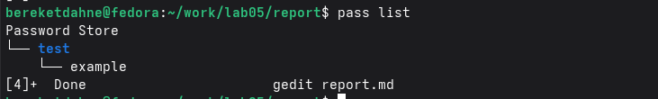
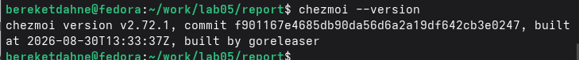
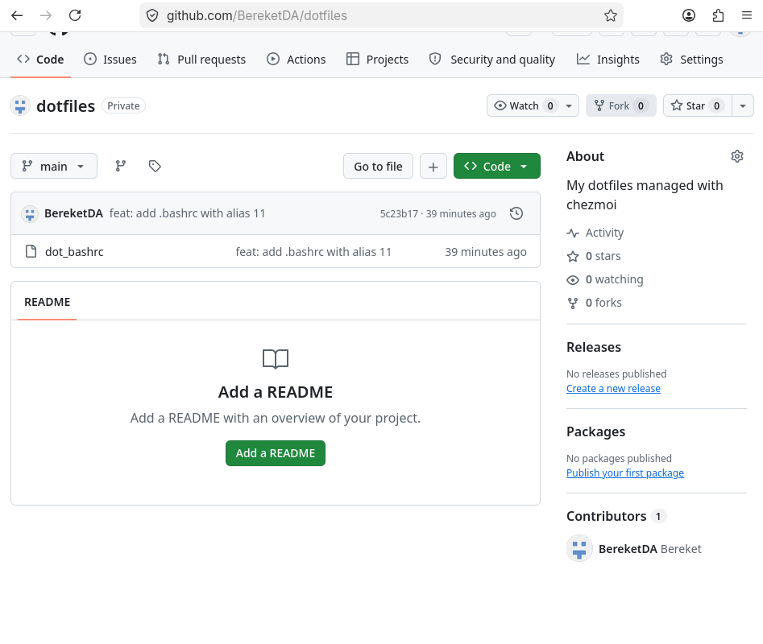

---
## Author
author:
  name: "Кебеде Берекет Дагне"
  email: "1032255864@rudn.ru"
  affiliation:
    - name: "Российский университет дружбы народов"
      country: "Российская Федерация"
      city: "Москва"
## Title
title: "Менеджер паролей pass и управление файлами конфигурации chezmoi"
subtitle: "Лабораторная работа № 5"
lang: ru-RU
## Presentation output formats
format:
  revealjs:
    theme: serif
    slide-level: 2
    transition: none
  beamer:
    pdf-engine: xelatex
    slide-level: 2
    aspectratio: 169
    section-titles: true
    mainfont: "DejaVu Serif"
    monofont: "DejaVu Sans Mono"
---

# Информация

## Докладчик

:::::::::::::: {.columns align=center}
::: {.column width="70%"}

- **Кебеде Берекет Дагне**
- Российский университет дружбы народов (РУДН)
- [1032255864@rudn.ru](mailto:1032255864@rudn.ru)

:::
::: {.column width="30%"}

**Лабораторная работа № 5**

`pass` и `chezmoi`

:::
::::::::::::::

::: notes
- Представиться, назвать номер лабораторной работы и её тему.
:::

# Вводная часть

## Актуальность

- Для работы в Unix необходимо безопасно хранить пароли.
- Пользовательские файлы конфигурации удобно поддерживать в одном месте.
- В лабораторной работе для этих задач используются `pass` и `chezmoi`.

::: notes
- Объяснить, зачем используются менеджер паролей и система управления dotfiles.
:::

## Цель и задачи

**Цель:** установить и настроить менеджер паролей `pass` и систему управления файлами конфигурации `chezmoi`.

**Задачи:**

- Установить `pass` и создать хранилище паролей.
- Добавить тестовый пароль.
- Установить `chezmoi` и создать репозиторий `dotfiles`.
- Добавить `.bashrc` в управление и отправить изменения на GitHub.

::: notes
- Перечислить задачи в порядке выполнения лабораторной работы.
:::

## Материалы и методы

- Терминал Linux и менеджер пакетов `dnf`.
- `pass` — управление паролями с помощью GPG.
- `chezmoi` — управление пользовательскими файлами конфигурации.
- Git и GitHub — хранение и публикация изменений.

::: notes
- Назвать программные инструменты, использованные в работе.
:::

# Основные понятия

## Что такое pass?

- Менеджер паролей для Unix.
- Использует GPG для шифрования.
- Хранит пароли в файловой системе.
- Поддерживает синхронизацию через Git.

::: notes
- Кратко объяснить устройство и назначение менеджера паролей pass.
:::

## Что такое chezmoi?

- Инструмент для управления файлами конфигурации (*dotfiles*).
- Использует шаблоны Go.
- Поддерживает работу с разными машинами.
- Интегрируется с Git.

::: notes
- Пояснить, что к dotfiles относится, например, файл .bashrc.
:::

# Выполнение работы

## Настройка pass

1. Установлен `pass`.
2. Инициализировано хранилище паролей.
3. Добавлен тестовый пароль.

::: notes
- Рассказать о первых трёх действиях из исходной презентации.
- Далее показать скриншоты инициализации и тестового пароля.
:::

## Настройка chezmoi

4. Установлен `chezmoi`.
5. Создан репозиторий `dotfiles`.
6. Файл `.bashrc` добавлен в управление.
7. Изменения отправлены на GitHub.

::: notes
- Перечислить шаги по настройке chezmoi и публикации файлов конфигурации.
:::

# Иллюстрации выполнения работы

## Инициализация pass

{width=75%}

::: notes
- Показать инициализацию хранилища pass.
:::

## Тестовый пароль

{width=75%}

::: notes
- Показать работу с тестовой записью в хранилище паролей.
:::

## Управление конфигурацией chezmoi

{width=75%}

::: notes
- Показать работу с файлом конфигурации через chezmoi.
:::

## Репозиторий dotfiles на GitHub

{width=75%}

::: notes
- Продемонстрировать репозиторий dotfiles на GitHub.
:::

# Результаты

## Полученные результаты

- `pass` установлен и инициализирован.
- Тестовый пароль сохранён.
- `chezmoi` установлен.
- Репозиторий `dotfiles` создан.
- Файл `.bashrc` добавлен в управление.
- Изменения отправлены на GitHub.

::: notes
- Перечислить результаты из исходной презентации и лабораторного отчёта.
:::

# Заключение

## Вывод

`pass` и `chezmoi` помогают управлять паролями и настройками системы.

В ходе работы были настроены хранилище паролей и управление файлом `.bashrc`, а изменения конфигурации отправлены в репозиторий `dotfiles`.

::: notes
- Подвести итог: установка и настройка pass и chezmoi выполнены.
:::

## Спасибо за внимание!

::: notes
- Поблагодарить слушателей и предложить задать вопросы.
:::
