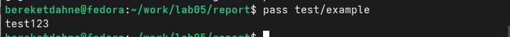

---
## Author
author:
  name: "Кебеде Берекет Дагне"
  email: 1032255864@rudn.ru
  affiliation:
    - name: Российский университет дружбы народов
      country: Российская Федерация
      postal-code: 117198
      city: Москва
      address: ул. Миклухо-Маклая, д. 6

## Title
title: "Лабораторная работа № 5"
subtitle: "Менеджер паролей pass и управление файлами конфигурации chezmoi"
lang: ru
mainfont: "DejaVu Serif"
monofont: "DejaVu Sans Mono"
pdf-engine: xelatex
abstract: |
  В отчёте представлены результаты лабораторной работы № 5 по установке
  и настройке менеджера паролей pass и системы управления файлами
  конфигурации chezmoi. Описаны создание хранилища паролей,
  работа с тестовой записью, настройка репозитория dotfiles,
  добавление файла .bashrc в управление и публикация изменений на GitHub.
keywords: [лабораторная работа, Linux, pass, chezmoi, dotfiles, GitHub]
---

# Введение

## Актуальность

Управление паролями и пользовательскими конфигурационными файлами
является частью настройки рабочей среды Linux. В данной лабораторной
работе рассматриваются инструменты `pass` и `chezmoi`, а также
хранение файлов конфигурации в репозитории `dotfiles`.

## Цель работы

Установить и настроить менеджер паролей `pass` и систему управления
файлами конфигурации `chezmoi`.

## Задачи

- Установить менеджер паролей `pass` и дополнение `pass-otp`.
- Инициализировать хранилище паролей.
- Добавить и получить тестовую запись пароля.
- Установить `chezmoi`.
- Создать приватный репозиторий `dotfiles` на GitHub.
- Инициализировать `chezmoi` с использованием созданного репозитория.
- Добавить файл `.bashrc` в управление `chezmoi` и применить изменения.
- Зафиксировать и отправить изменения в репозиторий GitHub.

## Объект и предмет исследования

Объект исследования — средства управления паролями и файлами
конфигурации в Linux. Предмет исследования — настройка и применение
`pass` и `chezmoi`, а также использование Git для хранения изменений
файлов конфигурации.

## Методы исследования

Практическое выполнение команд в терминале Linux. В ходе работы
использовались пакетный менеджер `dnf`, команды `pass` и `chezmoi`,
а также команды Git для фиксации и отправки изменений.

## Схема выполнения работы

На @fig-flowchart представлена общая последовательность действий
при выполнении лабораторной работы.

::: {#fig-flowchart}

```{mermaid}
%%| fig-width: 100%
graph TD
    A([Начало]) --> B[Установить pass и pass-otp]
    B --> C[Инициализировать хранилище паролей]
    C --> D[Добавить и проверить тестовый пароль]
    D --> E[Установить chezmoi]
    E --> F[Создать репозиторий dotfiles на GitHub]
    F --> G[Инициализировать chezmoi]
    G --> H[Добавить .bashrc и применить изменения]
    H --> I[Отправить изменения на GitHub]
    I --> J([Конец])
```

Блок-схема выполнения лабораторной работы № 5

:::

# Теоретическая часть

Менеджер паролей `pass` используется в лабораторной работе для
инициализации хранилища, сохранения и получения тестового пароля.
Система `chezmoi` применяется для управления файлом конфигурации
`.bashrc`. Для хранения управляемых файлов используется репозиторий
`dotfiles`, а для публикации изменений — Git.

В @tbl-tools перечислены основные команды и их назначения.

| Команда | Назначение |
|---------|------------|
| `dnf install` | Установка `pass` и `pass-otp` |
| `pass init` | Инициализация хранилища паролей |
| `pass insert` | Добавление записи в хранилище |
| `pass test/example` | Получение тестовой записи |
| `chezmoi init` | Инициализация управления конфигурацией |
| `chezmoi add` | Добавление файла под управление |
| `chezmoi apply -v` | Применение изменений |
| `git add`, `git commit`, `git push` | Подготовка, фиксация и отправка изменений |

: Основные команды лабораторной работы {#tbl-tools}

# Материалы и методы

Для выполнения работы использовались терминал Linux, `pass`,
`pass-otp`, `chezmoi`, Git и приватный репозиторий GitHub `dotfiles`.
Тестовая запись сохранялась по пути `test/example` в хранилище
`pass`. В систему управления `chezmoi` добавлялся файл `~/.bashrc`.

# Выполнение лабораторной работы

## 1. Установка менеджера паролей pass

```bash
sudo dnf install pass pass-otp -y
```

## 2. Инициализация хранилища паролей

```bash
pass init 9E692067E5AE35381B4AE01D7895ED926D4FA4D2
```

В исходном отчёте данная команда используется для инициализации
хранилища. Соответствующий скриншот приведён на @fig-pass-init.

## 3. Добавление тестового пароля

```bash
pass insert test/example
pass test/example
```

Был создан тестовый пароль и успешно извлечён. Результат
показан на @fig-pass-test.

## 4. Установка chezmoi

```bash
sh -c "$(curl -fsSL https://chezmoi.io/get)"
```

## 5. Создание репозитория dotfiles

На GitHub был создан приватный репозиторий `dotfiles`.
Скриншот репозитория приведён на @fig-github-dotfiles.

## 6. Инициализация chezmoi

```bash
chezmoi init git@github.com:BereketDA/dotfiles.git
```

## 7. Добавление файлов в управление

```bash
echo 'alias ll="ls -la"' >> ~/.bashrc
chezmoi add ~/.bashrc
chezmoi apply -v
```

Файл `.bashrc` был добавлен в управление `chezmoi`.
Соответствующий скриншот приведён на @fig-chezmoi.

## 8. Публикация на GitHub

```bash
cd ~/.local/share/chezmoi
git add .
git commit -m "feat: add .bashrc with alias ll"
git push
```

В исходном отчёте указано, что изменения отправлены на GitHub.

# Результаты

По результатам выполнения работы, указанным в исходном отчёте:

- `pass` установлен и инициализирован;
- тестовый пароль сохранён и извлечён;
- `chezmoi` установлен;
- репозиторий `dotfiles` создан;
- `.bashrc` добавлен в управление;
- изменения отправлены на GitHub.

На @fig-pass-init показана инициализация `pass`.

{#fig-pass-init width=70%}

На @fig-pass-test показана работа с тестовым паролем.

{#fig-pass-test width=70%}

На @fig-chezmoi показана работа с `chezmoi`.

{#fig-chezmoi width=70%}

На @fig-github-dotfiles показан репозиторий GitHub.

{#fig-github-dotfiles width=70%}

# Обсуждение результатов

В ходе лабораторной работы были последовательно выполнены настройки
менеджера паролей `pass` и системы `chezmoi`. Проверка тестового пароля
позволила убедиться в работе хранилища, а добавление `.bashrc` и
публикация изменений на GitHub продемонстрировали использование
репозитория для управления конфигурационным файлом.

# Заключение

В ходе выполнения лабораторной работы № 5 я:

1. Установил и настроил менеджер паролей `pass`.
2. Создал и извлёк тестовый пароль.
3. Установил `chezmoi` для управления файлами конфигурации.
4. Создал приватный репозиторий `dotfiles`.
5. Добавил `.bashrc` в управление `chezmoi`.
6. Опубликовал изменения на GitHub.

Таким образом, цель работы — установить и настроить `pass` и `chezmoi` —
была полностью достигнута.

# Список литературы {.unnumbered}

::: {#refs}
:::

\appendix

# Приложение А. Основные пути и обозначения {.appendix}

- `test/example` — тестовая запись в хранилище `pass`.
- `~/.bashrc` — файл конфигурации, добавленный в управление `chezmoi`.
- `~/.local/share/chezmoi` — каталог, использованный для публикации изменений.
- `dotfiles` — приватный репозиторий GitHub, созданный в ходе работы.
