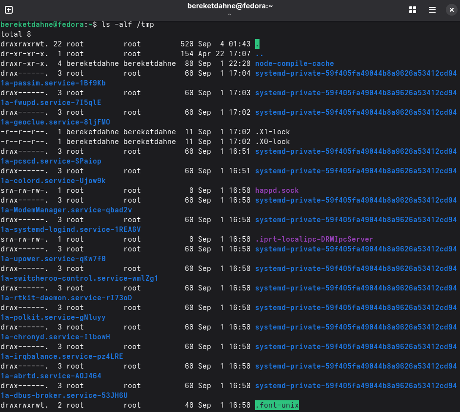
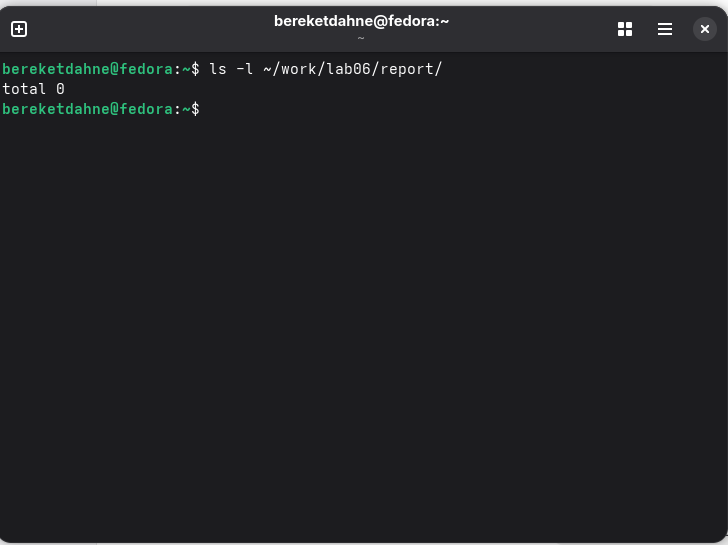

---
## Author
author:
  name: "Кебеде Берекет Дагне"
  email: "1032255864@rudn.ru"
  affiliation:
    - name: "Российский университет дружбы народов"
      country: "Российская Федерация"
      city: "Москва"
## Title
title: "Основы интерфейса командной строки Unix"
subtitle: "Лабораторная работа № 6"
date: "2026-09-04"
lang: ru-RU
## Presentation output formats
format:
  revealjs:
    theme: serif
    slide-level: 2
    transition: none
  beamer:
    pdf-engine: xelatex
    slide-level: 2
    aspectratio: 169
    section-titles: true
    mainfont: "DejaVu Serif"
    monofont: "DejaVu Sans Mono"
---

# Информация

## Докладчик

:::::::::::::: {.columns align=center}
::: {.column width="70%"}

- **Кебеде Берекет Дагне**
- Российский университет дружбы народов (РУДН)
- [1032255864@rudn.ru](mailto:1032255864@rudn.ru)

:::
::: {.column width="30%"}

**Лабораторная работа № 6**

Основы интерфейса командной строки Unix

:::
::::::::::::::

::: notes
- Представиться и назвать тему лабораторной работы.
:::

# Вводная часть

## Актуальность

- Командная строка позволяет взаимодействовать с системой Unix посредством текстовых команд.
- Для работы с файлами и каталогами необходимо знать основные команды и их опции.
- История команд и встроенная справка помогают выполнять повседневные операции.

::: notes
- Кратко объяснить, зачем пользователю навыки работы с терминалом.
:::

## Цель и задачи

**Цель:** приобретение практических навыков взаимодействия пользователя с системой посредством командной строки.

**Задачи:**

- Определить домашний и текущий каталоги.
- Изучить содержимое каталогов и опции `ls`.
- Создать и удалить каталоги.
- Использовать справку `man` и историю команд.

::: notes
- Цель сохранена из исходной презентации; задачи соответствуют выполненной работе.
:::

## Материалы и методы

- Командная строка Unix.
- Команды навигации: `pwd`, `cd`, `ls`.
- Команды работы с каталогами: `mkdir`, `rm`, `rmdir`.
- Справочная система `man` и история команд `history`.

::: notes
- Перечислить команды, которые использовались для выполнения заданий.
:::

# Основные команды

## Команды командной строки

| Команда | Назначение |
|---------|------------|
| `pwd` | Показать текущий каталог |
| `cd` | Сменить каталог |
| `ls` | Просмотреть содержимое каталога |
| `mkdir` | Создать каталог |
| `rm` | Удалить файл или каталог |
| `rmdir` | Удалить пустой каталог |
| `man` | Показать руководство по команде |
| `history` | Показать историю команд |

::: notes
- Объяснить назначение основных команд из исходной презентации.
- Уточнить, что для удаления каталога с содержимым используется `rm -r`.
:::

## Опции команды ls

| Опция | Назначение |
|-------|------------|
| `-l` | Подробная информация |
| `-a` | Показать скрытые файлы |
| `-F` | Показать тип файлов |
| `-R` | Рекурсивный просмотр |
| `-t` | Сортировка по времени |

::: notes
- Сравнить краткий и подробный вывод команды `ls`.
- Показать, для чего нужны отдельные опции.
:::

# Выполнение работы

## Что было сделано

1. Определён домашний каталог.
2. Изучено содержимое `/tmp`.
3. Проверено наличие `/var/spool/cron`.
4. Созданы и удалены каталоги.
5. Изучены опции `ls` через `man`.
6. Использована история команд.

::: notes
- Перечислить шесть шагов из исходной презентации.
- Далее показать снимки экрана, относящиеся к этим действиям.
:::

# Иллюстрации выполнения работы

## Домашний каталог

{width=75%}

::: notes
- Показать результат работы в домашнем каталоге.
:::

## Содержимое каталога /tmp

{width=75%}

::: notes
- Показать пример просмотра каталога /tmp.
:::

## Создание и удаление каталогов

{width=75%}

::: notes
- Показать создание и удаление каталогов средствами командной строки.
:::

## История команд

{width=75%}

::: notes
- Показать историю выполненных команд.
:::

# Результаты

## Полученные результаты

- Изучены команды для навигации по файловой системе Unix.
- Освоен просмотр содержимого каталогов с разными опциями `ls`.
- Выполнены операции создания и удаления каталогов.
- Использованы руководство `man` и история команд.

::: notes
- Кратко перечислить практические навыки, полученные в ходе работы.
:::

# Заключение

## Выводы

Командная строка Unix предоставляет мощные возможности для управления системой.

В ходе лабораторной работы были отработаны основные операции с каталогами, изучены опции `ls`, справка `man` и история команд.

::: notes
- Подвести итог и повторить основную мысль из исходной презентации.
:::

## Спасибо за внимание!

::: notes
- Поблагодарить аудиторию и предложить задать вопросы.
:::
