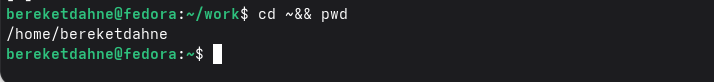
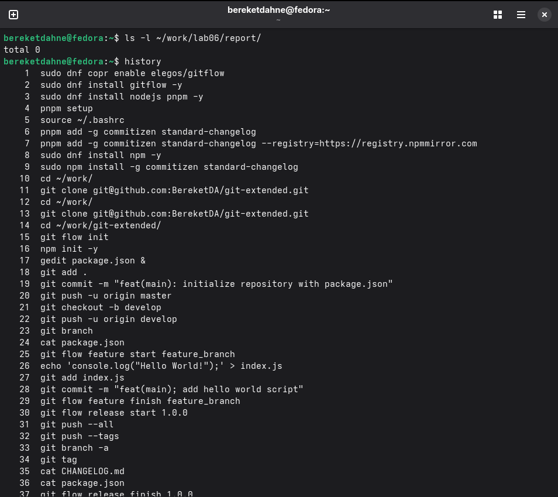

---
## Author
author:
  name: "Кебеде Берекет Дагне"
  email: 1032255864@rudn.ru
  affiliation:
    - name: Российский университет дружбы народов
      country: Российская Федерация
      postal-code: 117198
      city: Москва
      address: ул. Миклухо-Маклая, д. 6

## Title
title: "Лабораторная работа № 6"
subtitle: "Основы интерфейса командной строки Unix"
date: "2026-09-04"
lang: ru
mainfont: "DejaVu Serif"
monofont: "DejaVu Sans Mono"
pdf-engine: xelatex
abstract: |
  В данном отчёте представлены результаты выполнения лабораторной работы № 6,
  посвящённой основам интерфейса командной строки Unix. Рассмотрены
  навигация по каталогам, просмотр их содержимого, создание и удаление
  каталогов, работа со справочной системой и историей команд.
  Приведены выполненные команды, результаты работы и ответы на контрольные вопросы.
keywords: [лабораторная работа, Unix, командная строка, Linux, терминал]
---

# Введение

## Актуальность

Командная строка Unix предоставляет текстовый интерфейс для управления
файлами и каталогами, получения справочной информации и повторного
выполнения команд. Знание основных команд необходимо для взаимодействия
с системой через терминал.

## Цель работы

Приобретение практических навыков взаимодействия пользователя с системой
посредством командной строки.

## Задачи

- Определить абсолютный путь домашнего и текущего каталогов с помощью `pwd`.
- Перейти в каталог `/tmp` и просмотреть его содержимое с разными опциями `ls`.
- Проверить наличие подкаталога `cron` в `/var/spool`.
- Просмотреть содержимое домашнего каталога и сведения о владельцах файлов.
- Создать и удалить каталоги командами `mkdir`, `rmdir` и `rm -r`.
- Изучить опции команды `ls` с помощью `man`.
- Ознакомиться с историей команд и способами повторного выполнения команд.
- Ответить на контрольные вопросы.

## Объект и предмет исследования

Объект исследования — интерфейс командной строки Unix.
Предмет исследования — команды для навигации по файловой системе,
просмотра содержимого каталогов, создания и удаления каталогов,
получения справки и использования истории команд.

## Методы исследования

Практическое выполнение команд в терминале и изучение выводимой ими
информации. Для проверки действий использовались команды `pwd`, `ls`,
`mkdir`, `rmdir`, `rm`, `man` и `history`.

## Схема выполнения работы

На @fig-flowchart представлена общая последовательность действий,
выполненных в лабораторной работе.

::: {#fig-flowchart}

```{mermaid}
%%| fig-width: 100%
graph TD
    A([Начало]) --> B[Определить домашний каталог]
    B --> C[Перейти в /tmp и просмотреть содержимое]
    C --> D[Проверить /var/spool/cron]
    D --> E[Просмотреть домашний каталог]
    E --> F[Создать и удалить каталоги]
    F --> G[Изучить man и историю команд]
    G --> H[Зафиксировать результаты и ответить на вопросы]
    H --> I([Конец])
```

Блок-схема выполнения лабораторной работы № 6

:::

# Теоретическая часть

Для работы в командной строке Unix используются команды, позволяющие
изменять текущий каталог, просматривать файлы и каталоги, создавать и
удалять каталоги, получать справочную информацию и обращаться к истории
ранее введённых команд.

В @tbl-commands приведены команды, изученные в данной лабораторной работе.

| Команда | Назначение |
|---------|------------|
| `cd` | Переход в другой каталог |
| `pwd` | Вывод абсолютного пути текущего каталога |
| `ls` | Просмотр содержимого каталога |
| `ls -l` | Подробный список файлов и каталогов |
| `ls -a` | Показ скрытых файлов |
| `ls -alF` | Подробный список, включая скрытые файлы, с обозначением типов |
| `mkdir` | Создание каталога |
| `rmdir` | Удаление пустого каталога |
| `rm -r` | Рекурсивное удаление каталога и содержимого |
| `man` | Просмотр справочного руководства |
| `history` | Просмотр истории команд |

: Основные команды лабораторной работы {#tbl-commands}

# Материалы и методы

В ходе работы использовались терминал Unix и команды, приведённые
в @tbl-commands. Практические действия выполнялись в домашнем каталоге
`/home/bereketdahne`, временном каталоге `/tmp` и каталоге `/var/spool`.
Для упражнения с созданием и удалением использовались каталоги `newdir`,
`newdir/morefun`, `letters`, `memos` и `misk`.

# Выполнение лабораторной работы

## 1. Определение полного имени домашнего каталога

```bash
cd ~
pwd
```

Полное имя домашнего каталога: `/home/bereketdahne`.

## 2. Переход в каталог /tmp

```bash
cd /tmp
pwd
```

## 3. Просмотр содержимого каталога /tmp с различными опциями

```bash
ls
ls -l
ls -a
ls -alF
```

- `ls` — показывает имена файлов.
- `ls -l` — показывает подробную информацию.
- `ls -a` — показывает скрытые файлы.
- `ls -alF` — показывает подробную информацию, скрытые файлы и тип файлов.

## 4. Проверка наличия подкаталога cron в /var/spool

```bash
ls -l /var/spool/cron
```

В исходном отчёте отмечено: «Доступ запрещён. Каталог cron отсутствует».

## 5. Переход в домашний каталог и просмотр содержимого

```bash
cd ~
ls -l
```

Владельцем файлов и подкаталогов является пользователь `bereketdahne`.

## 6. Создание каталогов

```bash
mkdir newdir
mkdir newdir/morefun
mkdir letters memos misk
```

Каталоги `newdir`, `newdir/morefun`, `letters`, `memos`, `misk` созданы.

## 7. Удаление каталогов

```bash
rmdir letters memos misk
```

Каталоги `letters`, `memos`, `misk` удалены.

```bash
rm newdir
```

Команда `rm` не может удалить каталог (ошибка: `Is a directory`).

```bash
rm -r newdir
```

Каталог `newdir` и его содержимое удалены.

## 8. Использование команды man для изучения опций ls

```bash
man ls
```

Опция `-R` позволяет просматривать содержимое каталога и подкаталогов.
Опция `-t` сортирует по времени последнего изменения.

## 9. Использование истории команд

```bash
history
```

Команды из истории можно выполнить с помощью `!<номер_команды>`.

# Результаты

В исходном отчёте предусмотрены четыре скриншота. Ниже сохранены
их исходные имена и подписи.

На @fig-home-dir показан домашний каталог.

{#fig-home-dir width=70%}

На @fig-tmp-contents показано содержимое каталога `/tmp`.

{#fig-tmp-contents width=70%}

На @fig-directories показаны операции с каталогами.

{#fig-directories width=70%}

На @fig-history показана история команд.

{#fig-history width=70%}

# Обсуждение результатов

В ходе лабораторной работы были рассмотрены способы определения текущего
каталога, перемещения по файловой системе и просмотра содержимого каталогов.
Также были выполнены действия по созданию и удалению каталогов, изучению
справки по команде `ls` и работе с историей команд.

## Ответы на контрольные вопросы

**1. Что такое командная строка?**

Командная строка — это текстовый интерфейс для взаимодействия пользователя
с операционной системой путём ввода команд.

**2. При помощи какой команды можно определить абсолютный путь текущего каталога?**

Команда `pwd` (Print Working Directory). Пример: `pwd` выводит
`/home/bereketdahne`.

**3. При помощи какой команды и каких опций можно определить только тип файлов и их имена в текущем каталоге?**

Команда `ls -F` показывает тип файлов (каталог `/`, исполняемый файл `*`,
ссылка `@`).

**4. Каким образом отобразить информацию о скрытых файлах?**

Команда `ls -a` показывает все файлы, включая скрытые (начинающиеся с точки).

**5. При помощи каких команд можно удалить файл и каталог? Можно ли это сделать одной и той же командой?**

- Удаление файла: `rm имя_файла`.
- Удаление каталога: `rmdir имя_каталога` (пустой) или
  `rm -r имя_каталога` (с содержимым).
- Да, можно одной командой: `rm -r имя_каталога`.

**6. Каким образом можно вывести информацию о последних выполненных пользователем командах?**

Команда `history` выводит список последних выполненных команд.

**7. Как воспользоваться историей команд для их модифицированного выполнения?**

Команда `!<номер_команды>` выполняет указанную команду из истории.
Пример: `!5` выполнит команду под номером 5.

**8. Приведите примеры запуска нескольких команд в одной строке.**

Команды разделяются точкой с запятой: `cd /tmp; ls -l; pwd`.

**9. Дайте определение и приведите примеры символов экранирования.**

Символы экранирования используются для отмены специального значения символов.
Пример: `\*` означает обычную звёздочку, а не подстановку.

**10. Охарактеризуйте вывод информации на экран после выполнения команды ls с опцией l.**

Команда `ls -l` выводит: тип файла, права доступа, число ссылок,
владельца, размер, дату изменения и имя файла.

**11. Что такое относительный путь к файлу?**

Относительный путь указывает расположение файла относительно текущего каталога.
Пример: `cd ../` (переход на уровень выше).

**12. Как получить информацию об интересующей вас команде?**

Команда `man имя_команды` (например, `man ls`).

**13. Какая клавиша или комбинация клавиш служит для автоматического дополнения вводимых команд?**

Клавиша `Tab` (табуляция) для автодополнения команд и путей.

# Заключение

В ходе выполнения лабораторной работы № 6 я приобрёл практические навыки
взаимодействия с системой Unix через командную строку. Я научился:

- определять текущий каталог и перемещаться по файловой системе;
- просматривать содержимое каталогов с различными опциями;
- создавать и удалять каталоги;
- использовать справочную систему `man`;
- работать с историей команд.

Таким образом, цель работы — приобретение практических навыков
взаимодействия пользователя с системой посредством командной строки —
была полностью достигнута.

# Список литературы {.unnumbered}

::: {#refs}
:::

\appendix

# Приложение А. Основные обозначения {.appendix}

- `~` — домашний каталог пользователя.
- `..` — родительский каталог.
- `Tab` — клавиша автодополнения команд и путей.
- `-R` — рекурсивный вывод содержимого для `ls`.
- `-t` — сортировка по времени последнего изменения для `ls`.
