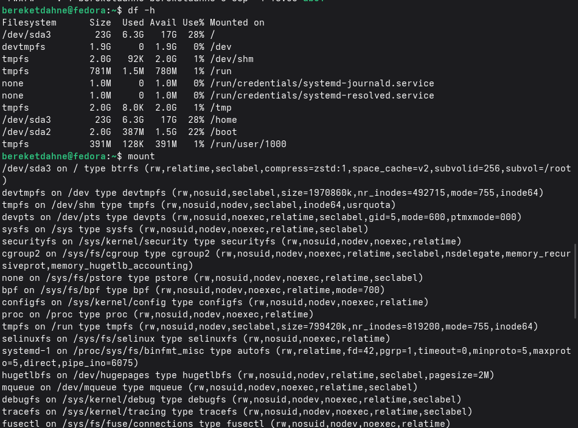
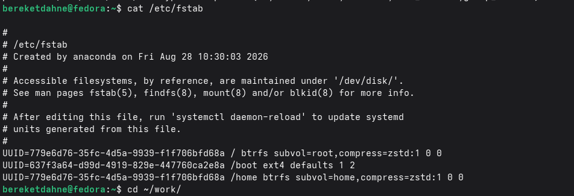

---
## Author
author:
  name: "Кебеде Берекет Дагне"
  email: "1032255864@rudn.ru"
  affiliation:
    - name: "Российский университет дружбы народов"
      country: "Российская Федерация"
      city: "Москва"
## Title
title: "Анализ файловой системы Linux"
subtitle: "Лабораторная работа № 7"
date: "2026-09-04"
lang: ru-RU
## Presentation output formats
format:
  revealjs:
    theme: serif
    slide-level: 2
    transition: none
  beamer:
    pdf-engine: xelatex
    slide-level: 2
    aspectratio: 169
    section-titles: true
    mainfont: "DejaVu Serif"
    monofont: "DejaVu Sans Mono"
---

# Информация

## Докладчик

:::::::::::::: {.columns align=center}
::: {.column width="70%"}

- **Кебеде Берекет Дагне**
- Российский университет дружбы народов (РУДН)
- [1032255864@rudn.ru](mailto:1032255864@rudn.ru)

:::
::: {.column width="30%"}

**Лабораторная работа № 7**

Анализ файловой системы Linux

:::
::::::::::::::

::: notes
- Представиться и назвать тему лабораторной работы.
:::

# Вводная часть

## Актуальность

- Файловая система Linux организует хранение файлов и каталогов.
- Для работы с данными используются команды создания, копирования, перемещения и удаления.
- Управление правами доступа и проверка файловой системы — важные задачи пользователя Linux.

::: notes
- Объяснить, зачем нужны навыки работы с файловой системой Linux.
:::

## Цель и задачи

**Цель:** ознакомление с файловой системой Linux и приобретение навыков работы с файлами и каталогами.

**Задачи:**

- Создать файлы и каталоги.
- Скопировать, переместить и переименовать файлы.
- Удалить файлы и каталоги.
- Изменить права доступа.
- Проанализировать файловую систему.

::: notes
- Цель сохранена из исходной презентации.
- Задачи соответствуют шести выполненным действиям.
:::

## Материалы и методы

- Командная строка Linux.
- Команды работы с файлами: `touch`, `mkdir`, `cp`, `mv`, `rm`.
- Изменение прав доступа с помощью `chmod`.
- Анализ файловой системы с помощью `df` и `mount`.

::: notes
- Назвать команды, которые использовались в лабораторной работе.
:::

# Основные команды

## Команды для работы с файловой системой

| Команда | Назначение |
|---------|------------|
| `touch` | Создание файла |
| `mkdir` | Создание каталога |
| `cp` | Копирование |
| `mv` | Перемещение/переименование |
| `rm` | Удаление |
| `chmod` | Изменение прав доступа |
| `df` | Анализ дискового пространства |
| `mount` | Просмотр смонтированных ФС |

::: notes
- Объяснить назначение восьми команд из исходной презентации.
:::

## Права доступа

| Символ | Значение |
|--------|----------|
| `r` | Чтение |
| `w` | Запись |
| `x` | Выполнение |
| `u` | Владелец |
| `g` | Группа |
| `o` | Остальные |

::: notes
- Пояснить обозначения прав доступа и категорий пользователей.
- Связать их с командой `chmod`.
:::

# Выполнение работы

## Что было сделано

1. Созданы файлы и каталоги.
2. Выполнено копирование файлов.
3. Выполнено перемещение и переименование.
4. Выполнено удаление файлов и каталогов.
5. Изменены права доступа.
6. Проанализирована файловая система.

::: notes
- Перечислить шесть шагов из исходной презентации.
- Затем показать подтверждающие скриншоты.
:::

# Иллюстрации выполнения работы

## Создание файлов и каталогов

{width=60%}

::: notes
- Показать создание файлов и каталогов в терминале.
:::

## Копирование и перемещение

{width=75%}

::: notes
- Показать выполненные операции копирования и перемещения.
:::

## Удаление и изменение прав: 1

{width=75%}

::: notes
- Прокомментировать первый скриншот операций удаления и изменения прав доступа.
:::

## Удаление и изменение прав: 2

{width=75%}

::: notes
- Прокомментировать второй скриншот операций удаления и изменения прав доступа.
:::

## Удаление и изменение прав: 3

{width=55%}

::: notes
- Прокомментировать третий скриншот операций удаления и изменения прав доступа.
:::

## Анализ файловой системы: 1

{width=60%}

::: notes
- Показать первый пример анализа файловой системы.
:::

## Анализ файловой системы: 2

{width=75%}

::: notes
- Показать второй пример анализа файловой системы.
:::

# Результаты

## Полученные результаты

- Созданы файлы и каталоги.
- Выполнены операции копирования, перемещения, переименования и удаления.
- Изменены права доступа.
- Проведён анализ файловой системы Linux.

::: notes
- Кратко перечислить выполненные операции.
:::

# Заключение

## Выводы

Файловая система Linux предоставляет мощные возможности для управления данными.

В ходе лабораторной работы были отработаны команды для работы с файлами и каталогами, изменения прав доступа и анализа файловой системы.

::: notes
- Повторить основной вывод исходной презентации.
- Указать, какие практические навыки были получены.
:::

## Спасибо за внимание!

::: notes
- Поблагодарить аудиторию и предложить задать вопросы.
:::
