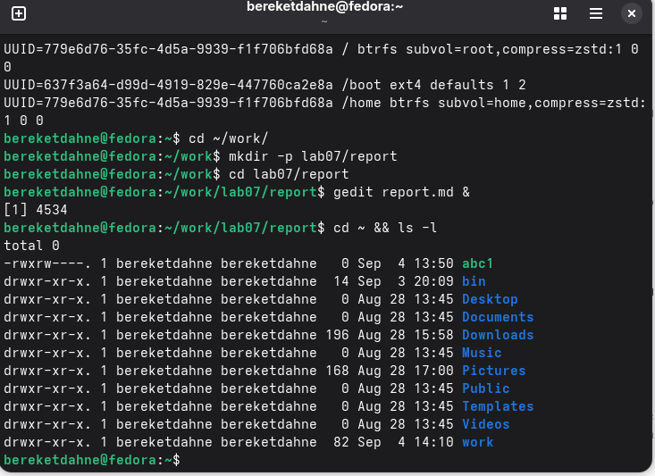
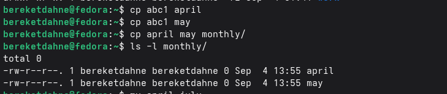
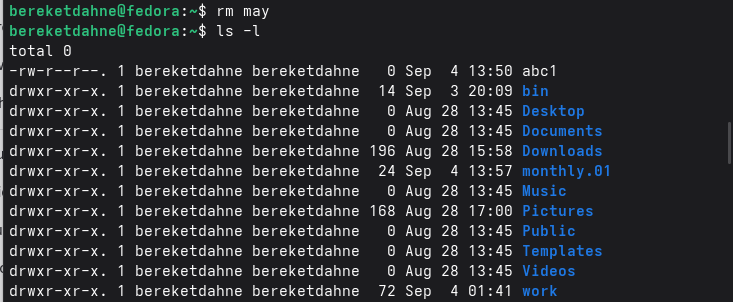
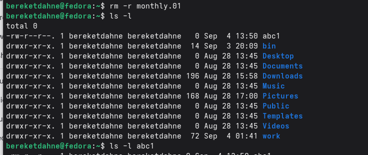
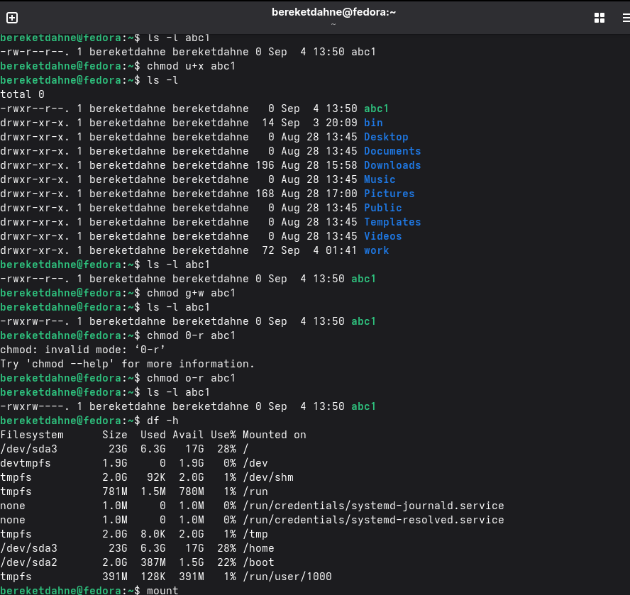

---
## Author
author:
  name: "Кебеде Берекет Дагне"
  email: 1032255864@rudn.ru
  affiliation:
    - name: Российский университет дружбы народов
      country: Российская Федерация
      postal-code: 117198
      city: Москва
      address: ул. Миклухо-Маклая, д. 6

## Title
title: "Лабораторная работа № 7"
subtitle: "Анализ файловой системы Linux"
date: "2026-09-04"
lang: ru
mainfont: "DejaVu Serif"
monofont: "DejaVu Sans Mono"
pdf-engine: xelatex
abstract: |
  В данном отчёте представлены результаты выполнения лабораторной работы № 7
  по анализу файловой системы Linux. Рассмотрены создание, копирование,
  перемещение и удаление файлов и каталогов, изменение прав доступа,
  а также изучение сведений о файловой системе. Приведены выполненные
  команды, ссылки на скриншоты и ответы на контрольные вопросы.
keywords: [лабораторная работа, Linux, файловая система, каталоги, права доступа]
---

# Введение

## Актуальность

Знание устройства файловой системы Linux и основных команд управления
файлами и каталогами необходимо для работы в терминале. Команды для
копирования, перемещения, удаления и настройки прав доступа позволяют
управлять файловыми объектами, а системные утилиты предоставляют
информацию об использовании дискового пространства и монтировании.

## Цель работы

Ознакомление с файловой системой Linux, её структурой, именами и содержимым
каталогов. Приобретение практических навыков по применению команд для работы
с файлами и каталогами, по управлению процессами, по проверке использования
диска и обслуживанию файловой системы.

## Задачи

- Создать файлы и каталог с помощью `touch` и `mkdir`.
- Выполнить копирование файлов командой `cp`.
- Переместить и переименовать файлы и каталог командой `mv`.
- Удалить файл и каталог командами `rm` и `rm -r`.
- Изменить права доступа к файлу командой `chmod`.
- Получить сведения о файловой системе командами `df`, `mount` и `cat`.
- Ответить на контрольные вопросы.

## Объект и предмет исследования

Объект исследования — файловая система Linux и её файловые объекты.
Предмет исследования — команды создания, копирования, перемещения,
удаления и изменения прав доступа, а также средства просмотра
информации о файловой системе.

## Методы исследования

Практическое выполнение команд в терминале Linux и наблюдение за
результатами операций с файлами и каталогами, изменения прав доступа
и получения сведений о файловой системе.

## Схема выполнения работы

На @fig-flowchart показана общая последовательность действий,
выполненных в лабораторной работе.

::: {#fig-flowchart}

```{mermaid}
%%| fig-width: 100%
graph TD
    A([Начало]) --> B[Создать файлы и каталог]
    B --> C[Скопировать файлы]
    C --> D[Переместить и переименовать]
    D --> E[Удалить файлы и каталог]
    E --> F[Изменить права доступа]
    F --> G[Проанализировать файловую систему]
    G --> H[Зафиксировать результаты и ответить на вопросы]
    H --> I([Конец])
```

Блок-схема выполнения лабораторной работы № 7

:::

# Теоретическая часть

В Linux для управления файлами и каталогами используются команды
создания, копирования, перемещения и удаления. Права доступа определяют,
какие пользователи могут читать, изменять и выполнять файлы.
Дополнительные команды позволяют проверить использование дискового
пространства и сведения о смонтированных файловых системах.

В @tbl-commands перечислены команды, рассмотренные в отчёте.

| Команда | Назначение |
|---------|------------|
| `touch` | Создание файла |
| `mkdir` | Создание каталога |
| `cp` | Копирование файлов (`cp -r` — каталогов) |
| `mv` | Перемещение и переименование файлов и каталогов |
| `rm` | Удаление файлов (`rm -r` — каталогов с содержимым) |
| `chmod` | Изменение прав доступа |
| `df -h` | Просмотр использования дискового пространства |
| `mount` | Просмотр смонтированных файловых систем |
| `cat /etc/fstab` | Просмотр содержимого файла настроек монтирования |

: Основные команды лабораторной работы {#tbl-commands}

# Материалы и методы

В ходе работы использовались терминал Linux и команды, указанные
в @tbl-commands. Для практических операций создавались файлы `abc1`,
`april`, `may` и каталог `monthly`. В процессе работы также использовались
имена `july` и `monthly.01`.

Действия выполнялись последовательно: создание файлов и каталога,
копирование, перемещение и переименование, удаление, изменение прав
доступа и просмотр информации о файловой системе.

# Выполнение лабораторной работы

## Создание файлов и каталогов

Созданы файлы `abc1`, `april`, `may` и каталог `monthly`:

```bash
touch abc1 april may
mkdir monthly
```

## Копирование файлов

С помощью `cp` выполнено копирование файлов:

```bash
cp abc1 april
cp abc1 may
cp april may monthly/
```

Файлы скопированы в каталог `monthly`.

## Перемещение и переименование файлов

```bash
mv april july
mv july monthly/
mv monthly monthly.01
```

Файл `april` переименован в `july` и перемещён в каталог `monthly`.
Каталог `monthly` переименован в `monthly.01`.

## Удаление файлов и каталогов

```bash
rm may
rm -r monthly.01
```

Файл `may` и каталог `monthly.01` удалены.

## Изменение прав доступа

```bash
chmod u+x abc1
chmod g+w abc1
chmod o-r abc1
```

Права доступа к файлу `abc1` изменены.

## Анализ файловой системы

```bash
df -h
mount
cat /etc/fstab
```

Получены сведения об использовании диска, смонтированных файловых
системах и настройках монтирования.

# Результаты

В исходном отчёте предусмотрены четыре группы скриншотов,
содержащие семь изображений. Ниже сохранены их исходные имена файлов.

На @fig-create-files показано создание файлов и каталога.

{#fig-create-files width=70%}

На @fig-copy-move показаны операции копирования и перемещения файлов.

{#fig-copy-move width=70%}

На @fig-delete-chmod, @fig-delete-chmod2 и @fig-delete-chmod3
представлены удаление файлов и изменение прав доступа.

{#fig-delete-chmod width=70%}

{#fig-delete-chmod2 width=70%}

{#fig-delete-chmod3 width=70%}

На @fig-fs-analysis и @fig-fs-analysis2 показан анализ файловой системы.

{#fig-fs-analysis width=70%}

{#fig-fs-analysis2 width=70%}

# Обсуждение результатов

В лабораторной работе рассмотрены операции создания, копирования,
перемещения, переименования и удаления файлов и каталогов в Linux.
Отдельно изучено изменение прав доступа к файлу `abc1`.
Команды `df -h`, `mount` и `cat /etc/fstab` использованы для знакомства
с информацией о файловой системе.

## Ответы на контрольные вопросы

**1. Какие команды используются для создания файлов и каталогов?**

Для создания файлов используется `touch имя_файла`, для создания каталогов —
`mkdir имя_каталога`.

**2. Какие команды используются для копирования файлов и каталогов?**

Для копирования файлов используется `cp`, для копирования каталогов — `cp -r`.

**3. Какие команды используются для перемещения и переименования файлов?**

Команда `mv` используется для перемещения и переименования файлов и каталогов.

**4. Как можно удалить файл или каталог?**

Для удаления файлов используется `rm`, для удаления пустых каталогов —
`rmdir`, для удаления каталогов с содержимым — `rm -r`.

**5. Что такое права доступа и как они изменяются?**

Права доступа определяют, кто может читать, записывать и выполнять файл.
Они изменяются командой `chmod`.

**6. Какие команды используются для анализа файловой системы?**

`df -h` показывает использование диска, `mount` показывает смонтированные
файловые системы, `cat /etc/fstab` показывает файл системных монтирований.

# Заключение

В ходе выполнения лабораторной работы № 7 я ознакомился с файловой
системой Linux, научился создавать, копировать, перемещать и удалять
файлы и каталоги, изменять права доступа, а также анализировать
файловую систему с помощью команд `df`, `mount` и `cat /etc/fstab`.

Таким образом, цель работы была полностью достигнута.
