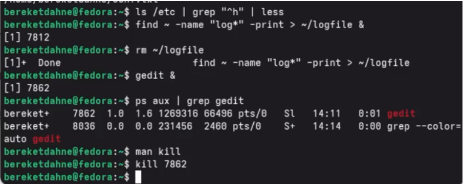

---
## Author
author:
  name: "Кебеде Берекет Дагне"
  email: "1032255864@rudn.ru"
  affiliation:
    - name: "Российский университет дружбы народов"
      country: "Российская Федерация"
      city: "Москва"
## Title
title: "Поиск файлов. Перенаправление ввода-вывода. Просмотр запущенных процессов"
subtitle: "Лабораторная работа № 8"
date: "2026-10-02"
lang: ru-RU
## Presentation output formats
format:
  revealjs:
    theme: serif
    slide-level: 2
    transition: none
  beamer:
    pdf-engine: xelatex
    slide-level: 2
    aspectratio: 169
    section-titles: true
    mainfont: "DejaVu Serif"
    monofont: "DejaVu Sans Mono"
---

# Информация

## Докладчик

:::::::::::::: {.columns align=center}
::: {.column width="70%"}

- **Кебеде Берекет Дагне**
- Российский университет дружбы народов (РУДН)
- [1032255864@rudn.ru](mailto:1032255864@rudn.ru)

:::
::: {.column width="30%"}

**Лабораторная работа № 8**

Поиск файлов, перенаправление ввода-вывода и процессы

:::
::::::::::::::

::: notes
- Представиться и назвать тему лабораторной работы.
:::

# Вводная часть

## Актуальность

- В Linux важно уметь находить файлы и фильтровать текстовые данные.
- Перенаправление позволяет сохранять вывод команд и обрабатывать его дальше.
- Управление процессами помогает контролировать запущенные программы.

::: notes
- Кратко объяснить, для чего нужны поиск, перенаправление и управление процессами.
:::

## Цель и задачи

**Цель:** ознакомиться с инструментами поиска файлов и фильтрации текстовых данных; приобрести практические навыки управления процессами.

**Задачи:**

- Изучить стандартные потоки ввода-вывода.
- Использовать перенаправление и конвейер команд.
- Выполнить поиск файлов и фильтрацию данных.
- Рассмотреть управление процессами и проверку диска.

::: notes
- Сформулировать цель из исходной презентации.
- Объяснить последовательность тем на следующих слайдах.
:::

## Материалы и методы

- Терминал Linux.
- Утилиты поиска: `find`, `grep`.
- Средства процессов: `ps`, `jobs`, `kill`, `gedit`.
- Средства проверки диска: `df`, `du`.
- Операторы оболочки: `>`, `>>`, `|`, `2>`, `&`.

::: notes
- Перечислить команды и операторы, которые используются в работе.
:::

# Основные понятия

## Потоки ввода-вывода

| Поток | Назначение | Дескриптор |
|--------|------------|------------|
| `stdin` | Стандартный ввод | `0` |
| `stdout` | Стандартный вывод | `1` |
| `stderr` | Стандартный вывод ошибок | `2` |

::: notes
- Пояснить, что у каждого стандартного потока есть числовой дескриптор.
:::

## Перенаправление и конвейер

| Оператор | Значение |
|----------|----------|
| `>` | Перезапись файла |
| `>>` | Добавление в файл |
| \| | Конвейер (pipe) |
| `2>` | Перенаправление ошибок |

::: notes
- Сравнить `>` и `>>`.
- Объяснить, как конвейер передаёт вывод одной команды другой.
:::

# Выполнение работы

## Поиск файлов

- Поиск по имени:

```bash
find ~ -name "c*" -print
```

- Поиск по содержимому:

```bash
grep ".conf" file.txt
```

::: notes
- Показать оба примера из исходного Markdown.
- `find` отбирает имена файлов, `grep` — строки текста по шаблону.
:::

## Управление процессами

- `ps aux` — список процессов.
- `gedit &` — запуск программы в фоне.
- `jobs` — список задач.
- `kill <PID>` — завершение процесса по его идентификатору.

::: notes
- Объяснить значение PID.
- Уточнить, что вместо `<PID>` при выполнении команды подставляют числовой идентификатор процесса.
:::

## Проверка диска

- `df -h` — использование дисковых разделов.
- `du -a ~` — размер файлов и каталогов домашнего каталога.

::: notes
- Сравнить назначение `df` и `du`.
:::

# Иллюстрации выполнения работы

## Запись вывода и поиск файлов

{width=75%}

::: notes
- Показать результат перенаправления вывода и поиск файлов с расширением `.conf`.
:::

## Поиск и управление процессами

{width=75%}

::: notes
- Показать выполнение поиска файлов и работу с процессами.
:::

## Проверка дискового пространства

{width=55%}

::: notes
- Показать информацию об использовании диска.
:::

# Результаты

## Полученные результаты

- Рассмотрены три стандартных потока ввода-вывода.
- Изучены перенаправление вывода и конвейер команд.
- Выполнены поиск файлов и фильтрация текста.
- Рассмотрены команды управления процессами и проверки диска.

::: notes
- Подвести итог практических действий и связать их с целью работы.
:::

# Заключение

## Выводы

Изучены инструменты поиска файлов, перенаправления ввода-вывода и управления процессами.

::: notes
- Повторить основной вывод из исходной презентации.
:::

## Спасибо за внимание!

::: notes
- Поблагодарить аудиторию и предложить задать вопросы.
:::
