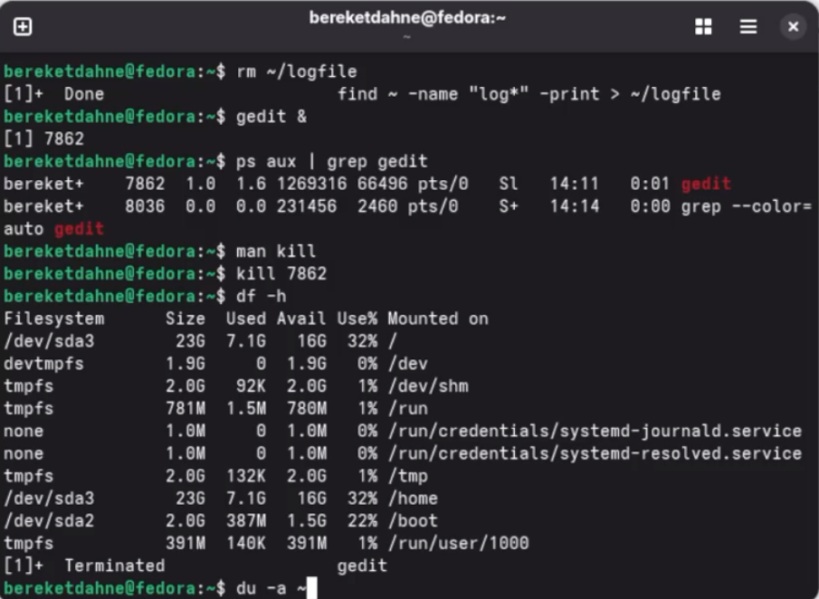

---
## Author
author:
  name: "Кебеде Берекет Дагне"
  email: 1032255864@rudn.ru
  affiliation:
    - name: Российский университет дружбы народов
      country: Российская Федерация
      postal-code: 117198
      city: Москва
      address: ул. Миклухо-Маклая, д. 6

## Title
title: "Лабораторная работа № 8"
subtitle: "Поиск файлов. Перенаправление ввода-вывода. Просмотр запущенных процессов"
date: "2026-10-02"
lang: ru
mainfont: "DejaVu Serif"
monofont: "DejaVu Sans Mono"
pdf-engine: xelatex
abstract: |
  В данном отчёте представлены результаты лабораторной работы № 8 по
  поиску файлов и фильтрации текстовых данных, перенаправлению
  ввода-вывода и управлению процессами в Linux. Рассмотрены
  проверка использования диска, работа с фоновыми процессами
  и ответы на контрольные вопросы.
keywords: [лабораторная работа, Linux, поиск файлов, перенаправление ввода-вывода, процессы]
---

# Введение

## Актуальность

Поиск файлов, фильтрация текстовых данных и управление процессами относятся
к повседневным задачам при работе в командной строке Linux.
Средства перенаправления ввода-вывода позволяют сохранять и обрабатывать
результаты команд, а утилиты работы с диском помогают оценивать
использование файловой системы.

## Цель работы

Ознакомление с инструментами поиска файлов и фильтрации текстовых данных.
Приобретение практических навыков по управлению процессами, по проверке
использования диска и обслуживанию файловых систем.

## Задачи

- Освоить запись и добавление вывода команд в текстовые файлы.
- Выполнить поиск файлов по именам и фильтрацию строк по шаблонам.
- Ознакомиться с конвейерами команд и просмотром результатов через `less`.
- Запустить команды и приложение в фоновом режиме.
- Найти идентификатор процесса и изучить способ его завершения.
- Проверить использование диска и найти каталоги домашней директории.
- Ответить на контрольные вопросы.

## Объект и предмет исследования

Объект исследования — работа с файлами, каталогами и процессами в Linux.
Предмет исследования — команды оболочки, применяемые для поиска файлов,
перенаправления потоков ввода-вывода, управления процессами
и проверки использования диска.

## Методы исследования

Практическое выполнение команд в терминале Linux, наблюдение за их выводом,
перенаправление результатов в файлы и просмотр сведений о процессах
и файловой системе.

## Схема выполнения работы

На @fig-flowchart представлена общая последовательность действий
при выполнении лабораторной работы.

::: {#fig-flowchart}

```{mermaid}
%%| fig-width: 100%
graph TD
    A([Начало]) --> B[Запись вывода команд в файлы]
    B --> C[Поиск и фильтрация файлов]
    C --> D[Работа с фоновыми процессами]
    D --> E[Просмотр PID и завершение процесса]
    E --> F[Проверка использования диска]
    F --> G[Фиксация результатов и ответы на вопросы]
    G --> H([Конец])
```

Блок-схема выполнения лабораторной работы № 8

:::

# Теоретическая часть

В Linux стандартный ввод (`stdin`) имеет дескриптор `0`, стандартный
вывод (`stdout`) — `1`, а поток ошибок (`stderr`) — `2`.
Операторы `>` и `>>` перенаправляют вывод в файл: первый заменяет
его содержимое, а второй добавляет новые данные в конец.
Конвейер `|` передаёт вывод одной команды на вход другой.
Символ `&` запускает команду в фоновом режиме.

В @tbl-command-tools кратко охарактеризованы утилиты,
рассмотренные в лабораторной работе.

| Команда | Назначение |
|---------|------------|
| `ls` | Вывод содержимого каталога |
| `grep` | Поиск строк, соответствующих шаблону |
| `find` | Поиск файлов и каталогов по заданным условиям |
| `less` | Постраничный просмотр текстового вывода |
| `ps` | Отображение информации о процессах |
| `kill` | Отправка сигнала процессу по PID |
| `df` | Сведения об использовании файловых систем |
| `du` | Оценка размера файлов и каталогов |
| `rm` | Удаление файлов |

: Основные команды, использованные в работе {#tbl-command-tools}

# Материалы и методы

Для выполнения работы использовались терминал Linux и стандартные
командные утилиты, перечисленные в @tbl-command-tools.
Рабочими объектами служили каталоги `/etc` и `~`, а также файлы
`~/file.txt`, `~/conf.txt` и `~/logfile`.

Выполнение включало последовательно запись вывода команд,
поиск по шаблонам, запуск фоновых процессов, определение PID,
просмотр справки по `kill`, проверку дискового пространства
и поиск каталогов.

# Выполнение лабораторной работы

## Запись файлов из `/etc` в `file.txt`

Вывод списка содержимого каталога `/etc` перенаправлен в файл `~/file.txt`:

```bash
ls /etc > ~/file.txt
```

## Добавление файлов из домашнего каталога

Вывод списка содержимого домашнего каталога добавлен в конец файла:

```bash
ls ~ >> ~/file.txt
```

## Поиск файлов с расширением `.conf`

В исходном отчёте для отбора строк из файла использована команда:

```bash
grep ".conf" ~/file.txt > ~/conf.txt
```

## Поиск файлов, начинающихся с символа `c`

```bash
find ~ -name "c*" -print
```

## Вывод файлов из `/etc`, начинающихся с `h`

```bash
ls /etc | grep "^h" | less
```

## Запуск процесса в фоновом режиме

Результат поиска файлов с именами, начинающимися на `log`, перенаправлен
в `~/logfile`; команда запущена в фоновом режиме:

```bash
find ~ -name "log*" -print > ~/logfile &
```

## Удаление `logfile`

```bash
rm ~/logfile
```

## Запуск `gedit` в фоновом режиме

```bash
gedit &
```

## Определение PID процесса `gedit`

```bash
ps aux | grep gedit
```

## Чтение справки по `kill` и завершение процесса

Команды из исходного отчёта:

```bash
man kill
kill <PID>
```

Здесь `<PID>` — обозначение идентификатора нужного процесса;
при выполнении команды его следует заменить числом, полученным из `ps`.

## Проверка использования диска

```bash
df -h
du -a ~
```

## Поиск всех каталогов в домашнем каталоге

```bash
find ~ -type d
```

# Результаты

В исходном отчёте предусмотрены три скриншота.
Результаты записи файлов и поиска `.conf` представлены на @fig-001.

{#fig-001 width=70%}

Поиск файлов и работа с процессами представлены на @fig-002.

{#fig-002 width=70%}

Проверка дискового пространства представлена на @fig-003.

{#fig-003 width=70%}

# Обсуждение результатов

В ходе работы использованы операции записи и добавления вывода в файлы,
конвейер команд, поиск файлов и каталогов по шаблонам, работа с фоновыми
процессами и команды проверки использования диска.

Следует учитывать, что шаблон `".conf"` в команде `grep` из исходного
отчёта является регулярным выражением: точка в нём означает любой символ.
Для поиска строк, заканчивающихся именно на `.conf`, требуется
шаблон `grep '\.conf$'`. Исходная выполненная команда выше сохранена
без изменений.

## Ответы на контрольные вопросы

**1. Какие потоки ввода-вывода вы знаете?**

`stdin` (стандартный ввод, дескриптор 0), `stdout` (стандартный вывод,
дескриптор 1), `stderr` (стандартный вывод ошибок, дескриптор 2).

**2. Объясните разницу между операцией `>` и `>>`.**

`>` перезаписывает файл, `>>` добавляет в конец файла.

**3. Что такое конвейер?**

Конвейер (`|`) передаёт вывод одной команды на вход другой команде.

**4. Что такое процесс? Чем это понятие отличается от программы?**

Процесс — это выполняющаяся программа. Программа — это файл с инструкциями,
процесс — это активное выполнение этих инструкций.

**5. Что такое PID и GID?**

PID (Process ID) — идентификатор процесса. GID (Group ID) — идентификатор группы.

**6. Что такое задачи и какая команда позволяет ими управлять?**

Задачи (jobs) — это процессы, запущенные в фоновом режиме.
Управляются командой `jobs`.

**7. Найдите информацию об утилитах `top` и `htop`. Каковы их функции?**

`top` и `htop` — утилиты для мониторинга процессов в реальном времени.
Показывают загрузку CPU, памяти, список процессов.

**8. Назовите и дайте характеристику команде поиска файлов. Приведите примеры использования этой команды.**

Команда `find` ищет файлы по заданным критериям.
Пример: `find ~ -name "*.txt" -print`.

**9. Можно ли по контексту (содержанию) найти файл? Если да, то как?**

Да, с помощью команды `grep`. Пример: `grep "текст" file.txt`.

**10. Как определить объем свободной памяти на жёстком диске?**

Команда `df -h`.

**11. Как определить объем вашего домашнего каталога?**

Команда `du -sh ~`.

**12. Как удалить зависший процесс?**

Найти PID командой `ps aux | grep имя`, затем `kill <PID>` или
`kill -9 <PID>` для принудительного завершения.

# Заключение

В ходе выполнения лабораторной работы № 8 я ознакомился с инструментами
поиска файлов и фильтрации текстовых данных. Я приобрёл практические
навыки по управлению процессами, проверке использования диска
и обслуживанию файловых систем.

Таким образом, цель работы была полностью достигнута.

# Список литературы {.unnumbered}

::: {#refs}
:::

\appendix

# Приложение А. Основные обозначения {.appendix}

- `stdin`, `stdout`, `stderr` — стандартные потоки ввода-вывода.
- `PID` — идентификатор процесса.
- `GID` — идентификатор группы.
- `~` — домашний каталог пользователя.
- `&` — выполнение команды в фоновом режиме.
