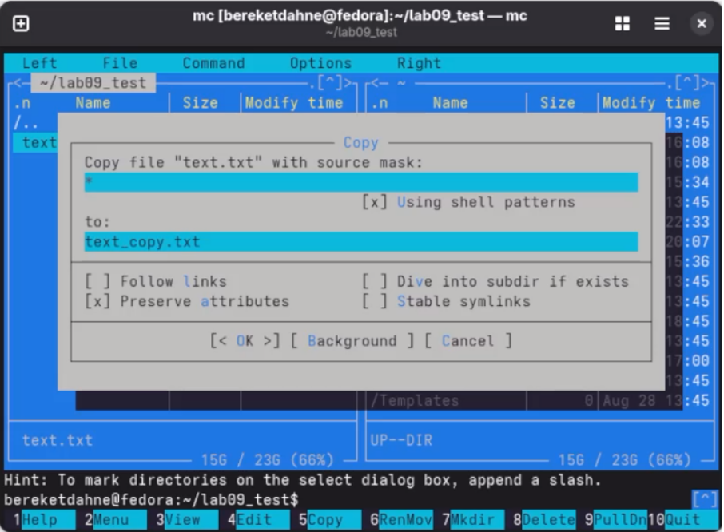

---
## Author
author:
  name: "Кебеде Берекет Дагне"
  email: "1032255864@rudn.ru"
  affiliation:
    - name: "Российский университет дружбы народов"
      country: "Российская Федерация"
      city: "Москва"
## Title
title: "Командная оболочка Midnight Commander"
subtitle: "Лабораторная работа № 9"
date: "2026-10-02"
lang: ru-RU
## Presentation output formats
format:
  revealjs:
    theme: serif
    slide-level: 2
    transition: none
  beamer:
    pdf-engine: xelatex
    slide-level: 2
    aspectratio: 169
    section-titles: true
    mainfont: "DejaVu Serif"
    monofont: "DejaVu Sans Mono"
---

# Информация

## Докладчик

:::::::::::::: {.columns align=center}
::: {.column width="70%"}

- **Кебеде Берекет Дагне**
- Российский университет дружбы народов (РУДН)
- [1032255864@rudn.ru](mailto:1032255864@rudn.ru)

:::
::: {.column width="30%"}

**Лабораторная работа № 9**

Командная оболочка Midnight Commander

:::
::::::::::::::

::: notes
- Представиться, назвать тему и номер лабораторной работы.
:::

# Вводная часть

## Актуальность

- В Linux важно уметь просматривать каталоги и работать с файлами.
- Midnight Commander предоставляет псевдографический интерфейс с двумя панелями.
- Встроенные инструменты помогают выполнять файловые операции и редактировать текст.

::: notes
- Объяснить, почему файловый менеджер удобен для практической работы в UNIX/Linux.
:::

## Цель и задачи

**Цель:** освоить основные возможности командной оболочки Midnight Commander и приобрести навыки просмотра каталогов и файлов.

**Задачи:**

- Запустить Midnight Commander и изучить панели и меню.
- Создать каталог `lab09_test` и файл `text.txt`.
- Отредактировать файл во встроенном редакторе.
- Выполнить копирование, переименование и удаление.

::: notes
- Кратко перечислить основные действия, выполненные в работе.
:::

## Материалы и методы

- Операционная система Linux.
- Файловый менеджер Midnight Commander (`mc`).
- Функциональные клавиши `F1`–`F10`.
- Меню для настройки панелей и выполнения файловых операций.
- Встроенный редактор и просмотрщик.

::: notes
- Представить интерфейс программы и основные способы управления.
:::

# Основные понятия

## Что такое Midnight Commander?

- Псевдографическая командная оболочка для UNIX/Linux.
- Две панели для отображения файлов.
- Встроенный редактор и просмотрщик.
- Поддержка файловых операций.

::: notes
- Показать, как две панели помогают работать с содержимым каталогов.
:::

## Основные клавиши — часть 1

| Клавиша | Действие |
|---------|----------|
| `F1` | Помощь |
| `F2` | Меню пользователя |
| `F3` | Просмотр |
| `F4` | Редактирование |
| `F5` | Копирование |

::: notes
- Пояснить назначение клавиш F1–F5.
:::

## Основные клавиши — часть 2

| Клавиша | Действие |
|---------|----------|
| `F6` | Перемещение |
| `F7` | Создание каталога |
| `F8` | Удаление |
| `F9` | Меню |
| `F10` | Выход |

::: notes
- Пояснить назначение клавиш F6–F10.
- Упомянуть, что переименование также выполняется через F6.
:::

## Меню Midnight Commander

- **Левая панель** — настройка левой панели.
- **Файл** — операции с файлами.
- **Команда** — команды Midnight Commander.
- **Настройки** — настройки внешнего вида.
- **Правая панель** — настройка правой панели.

::: notes
- Рассказать о назначении основных пунктов меню.
:::

# Выполнение работы

## Выполненные действия — часть 1

1. Запущен Midnight Commander.
2. Изучены панели и меню.
3. Создан каталог `lab09_test`.
4. Создан файл `text.txt`.

::: notes
- Описать запуск файлового менеджера и первые действия с каталогами.
:::

## Выполненные действия — часть 2

5. Файл отредактирован во встроенном редакторе.
6. Выполнены копирование, переименование и удаление файла.
7. Изучены меню **Файл**, **Команда** и **Настройки**.

::: notes
- Объяснить назначение встроенного редактора и файловых операций.
:::

# Иллюстрации выполнения работы

## Главное окно Midnight Commander

{width=55%}

::: notes
- Показать главное окно и две панели файлового менеджера.
:::

## Копирование файла

{width=55%}

::: notes
- Показать операцию копирования файла.
:::

## Перемещение и переименование

{width=55%}

::: notes
- Показать операцию перемещения или переименования файла.
:::

## Удаление файла

{width=55%}

::: notes
- Показать удаление файла.
:::

## Встроенный редактор

{width=55%}

::: notes
- Показать редактирование текстового файла во встроенном редакторе.
:::

# Результаты

## Полученные результаты

- Изучены две панели и меню Midnight Commander.
- Созданы каталог `lab09_test` и файл `text.txt`.
- Выполнено редактирование файла.
- Освоены копирование, переименование и удаление файлов.

::: notes
- Кратко подвести итог выполненных практических действий.
:::

# Заключение

## Выводы

Изучены основные возможности Midnight Commander. Получены навыки работы с файлами и каталогами через псевдографический интерфейс.

::: notes
- Повторить вывод из исходной презентации.
:::

## Спасибо за внимание!

::: notes
- Поблагодарить аудиторию и предложить задать вопросы.
:::
