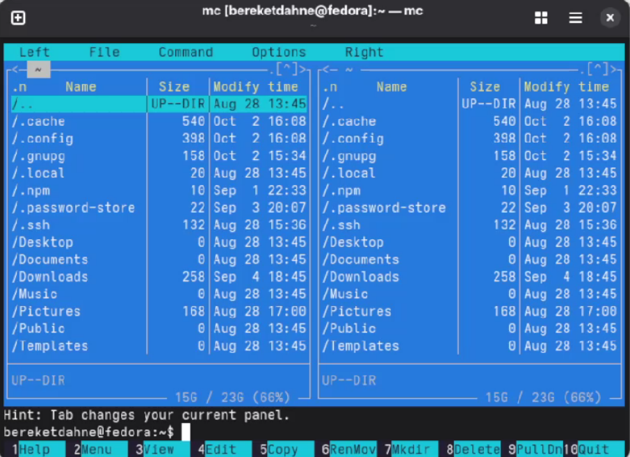
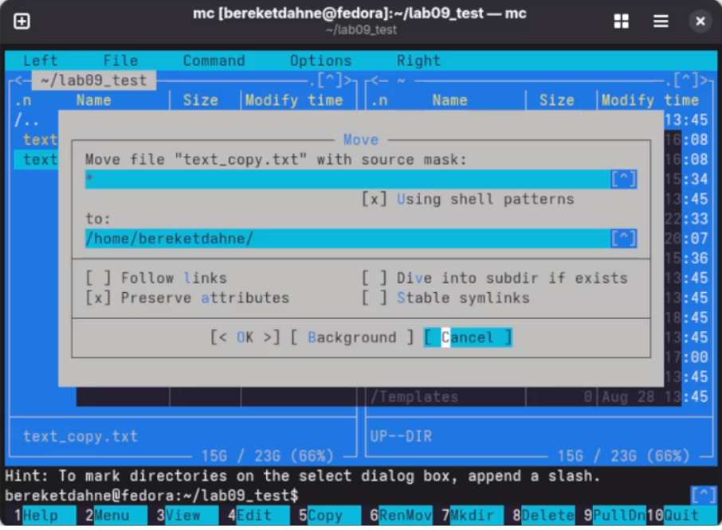
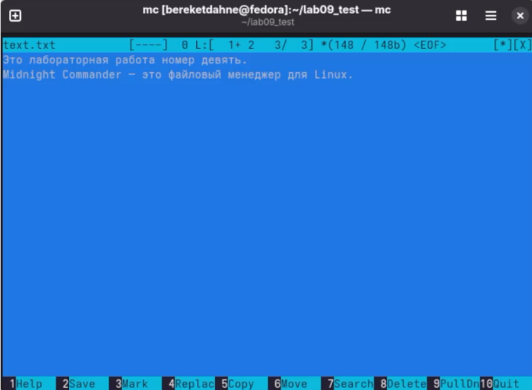

---
## Author
author:
  name: "Кебеде Берекет Дагне"
  email: 1032255864@rudn.ru
  affiliation:
    - name: Российский университет дружбы народов
      country: Российская Федерация
      city: Москва

## Title
title: "Лабораторная работа № 9"
subtitle: "Командная оболочка Midnight Commander"
date: "2026-10-02"
lang: ru
mainfont: "DejaVu Serif"
monofont: "DejaVu Sans Mono"
pdf-engine: xelatex
abstract: |
  В отчёте представлены результаты лабораторной работы № 9,
  посвящённой основным возможностям командной оболочки Midnight Commander.
  Рассмотрены навигация по каталогам, операции с файлами, работа с меню
  и встроенным редактором. Приведены результаты выполнения заданий
  и ответы на контрольные вопросы.
keywords: [лабораторная работа, Midnight Commander, файловый менеджер, Linux]
---

# Введение

## Актуальность

Midnight Commander позволяет просматривать каталоги и файлы и выполнять
основные файловые операции с помощью панелей, меню и клавиатурных команд.
Освоение этих возможностей необходимо для практической работы с файлами
и каталогами в командной оболочке.

## Цель работы

Освоение основных возможностей командной оболочки Midnight Commander.
Приобретение навыков практической работы по просмотру каталогов и файлов;
манипуляций с ними.

## Задачи

- Запустить Midnight Commander и изучить управление панелями.
- Создать каталог и текстовый файл.
- Отредактировать файл во встроенном редакторе.
- Выполнить копирование, переименование и удаление файла.
- Ознакомиться с меню Midnight Commander.
- Изучить основные команды встроенного редактора.
- Ответить на контрольные вопросы.

## Объект и предмет исследования

Объект исследования — файловый менеджер Midnight Commander.
Предмет исследования — его функции навигации, управления файлами и каталогами,
работы с меню и редактирования текстовых файлов.

## Методы исследования

Практическая работа с интерфейсом Midnight Commander:
запуск программы командой `mc`, выполнение операций с помощью
функциональных клавиш, создание и редактирование файлов.

## Схема выполнения работы

На @fig-flowchart показана последовательность действий,
описанных в отчёте.

::: {#fig-flowchart}

```{mermaid}
graph TD
    A([Начало]) --> B[Запустить Midnight Commander]
    B --> C[Изучить панели и меню]
    C --> D[Создать каталог и файл]
    D --> E[Отредактировать файл]
    E --> F[Копировать, переименовать и удалить файл]
    F --> G[Изучить встроенный редактор]
    G --> H[Зафиксировать результаты и ответить на вопросы]
    H --> I([Конец])
```

Схема выполнения лабораторной работы № 9

:::

# Теоретическая часть

Midnight Commander (`mc`) — файловый менеджер с двухпанельным интерфейсом.
Для выполнения основных операций используются функциональные клавиши.
В отчёте рассматриваются также режимы просмотра информации и дерева каталогов,
встроенные просмотрщик и редактор файлов.

В @tbl-mc-keys представлены клавиши, использованные в ходе работы.

| Клавиша | Действие |
|---------|----------|
| `Tab` | Переключение между панелями |
| `F9` | Открытие меню |
| `F7` | Создание каталога |
| `Shift + F4` | Создание файла |
| `F4` | Редактирование файла |
| `F5` | Копирование файла |
| `F6` | Переименование или перемещение |
| `F8` | Удаление файла |
| `F10` | Выход из программы |

: Основные клавиши управления Midnight Commander {#tbl-mc-keys}

# Материалы и методы

В работе использовались Midnight Commander и его встроенный текстовый редактор.
Практические задания выполнялись с каталогом `lab09_test` и файлом `text.txt`.
Для управления применялись команды меню и функциональные клавиши.

# Выполнение лабораторной работы

## 1. Запуск Midnight Commander

Для запуска файлового менеджера введена команда:

```bash
mc
```

## 2. Работа с панелями

Изучены переключение между панелями с помощью `Tab` и открытие меню с
помощью `F9`, а также основные команды, приведённые в @tbl-mc-keys.

## 3. Создание каталога и файла

Создан каталог `lab09_test` и файл `text.txt`.

## 4. Редактирование файла

Файл `text.txt` отредактирован во встроенном редакторе Midnight Commander.

## 5. Файловые операции

Выполнены следующие действия:

- копирование файла с именем `text_copy.txt`;
- переименование файла в `text_renamed.txt`;
- удаление файла `text_renamed.txt`.

## 6. Работа с меню

Изучены меню **Файл**, **Команда** и **Настройки**, доступные через `F9`.

## 7. Встроенный редактор

Изучены основные клавиши редактора:

- `F7` — поиск текста;
- `F2` — сохранение;
- `F10` — выход.

# Результаты

В исходном отчёте результаты представлены пятью скриншотами.

На @fig-mc-main показано главное окно Midnight Commander.

{#fig-mc-main width=70%}

На @fig-mc-copy показано копирование файла.

{#fig-mc-copy width=70%}

На @fig-mc-move показано перемещение или переименование файла.

{#fig-mc-move width=70%}

На @fig-mc-delete показано удаление файла.

{#fig-mc-delete width=70%}

На @fig-mc-editor показан встроенный редактор.

{#fig-mc-editor width=70%}

# Обсуждение результатов

В ходе работы были рассмотрены основные способы управления файлами в
Midnight Commander: операции с файлами и каталогами, использование меню
и встроенного редактора. Эти действия соответствуют поставленной цели
освоения основных возможностей файлового менеджера.

## Ответы на контрольные вопросы

**1. Какие режимы работы есть в mc? Охарактеризуйте их.**

- **Панельный режим** — основной режим с двумя панелями.
- **Режим Информация** — показывает сведения о файле и файловой системе.
- **Режим Дерево** — показывает структуру каталогов.
- **Встроенный редактор** — для редактирования текстовых файлов.
- **Встроенный просмотрщик** — для просмотра файлов.

**2. Какие операции с файлами можно выполнить как с помощью команд shell, так и с помощью меню (комбинаций клавиш) mc? Приведите несколько примеров.**

- Создание каталога: `mkdir` или `F7`.
- Копирование: `cp` или `F5`.
- Перемещение: `mv` или `F6`.
- Удаление: `rm` или `F8`.
- Редактирование: `nano` или `F4`.

**3. Опишите структуру меню левой (или правой) панели mc, дайте характеристику командам.**

Меню панели содержит: Формат списка, Порядок сортировки, Информация,
Дерево, Быстрый просмотр.

**4. Опишите структуру меню Файл mc, дайте характеристику командам.**

Меню Файл содержит: Просмотр, Редактирование, Копирование, Перемещение,
Создание каталога, Удаление, Права доступа, Выход.

**5. Опишите структуру меню Команда mc, дайте характеристику командам.**

Меню Команда содержит: Дерево каталогов, Поиск файла, Переставить панели,
Сравнить каталоги, История команд, Каталоги быстрого доступа.

**6. Опишите структуру меню Настройки mc, дайте характеристику командам.**

Меню Настройки содержит: Конфигурация, Внешний вид, Настройки панелей,
Подтверждения.

**7. Найдите и дайте характеристики встроенным командам mc.**

Встроенные команды: просмотр, редактирование, копирование, перемещение,
удаление, создание каталога, поиск.

**8. Найдите и дайте характеристики командам встроенного редактора mc.**

Команды редактора: поиск (`F7`), замена (`F4`), сохранение (`F2`),
выход (`F10`), выделение (`F3`), копирование (`F5`),
перемещение (`F6`), удаление (`F8`).

**9. Дайте характеристики средствам mc, которые позволяют создавать меню, определяемые пользователем.**

Файл меню пользователя (`F2`) — позволяет настроить контекстное меню.

**10. Дайте характеристики средствам mc, которые позволяют выполнять действия, определяемые пользователем, над текущим файлом.**

Файл расширений — позволяет задать действия при запуске файлов
с определённым расширением.

# Заключение

В ходе выполнения лабораторной работы № 9 я освоил основные возможности
командной оболочки Midnight Commander. Я научился просматривать каталоги
и файлы, выполнять операции копирования, перемещения, удаления,
создавать каталоги, редактировать файлы во встроенном редакторе
и использовать меню `mc`.

Таким образом, цель работы была полностью достигнута.
