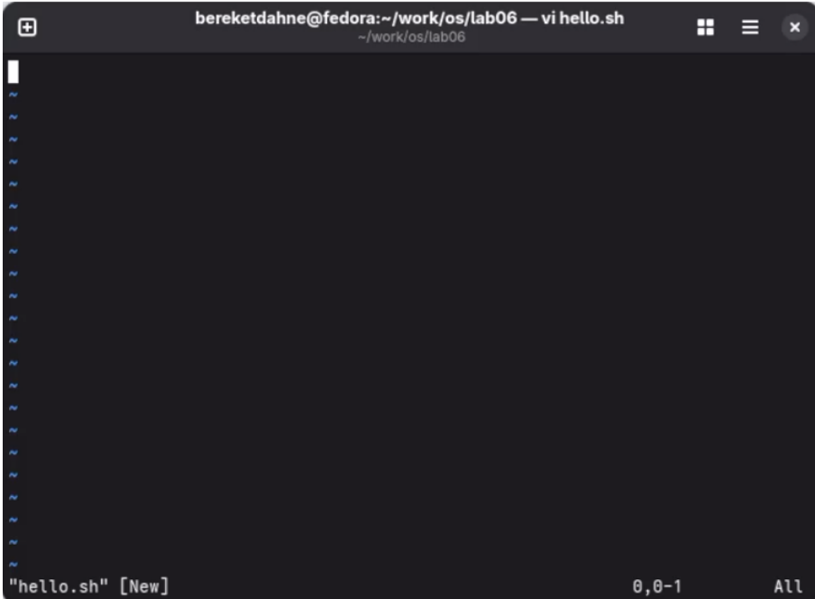
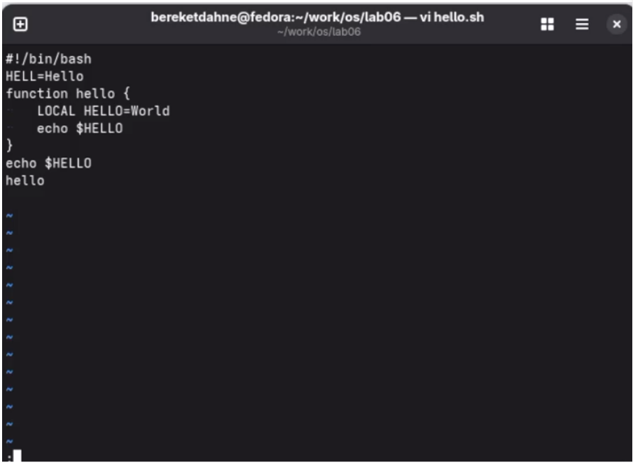
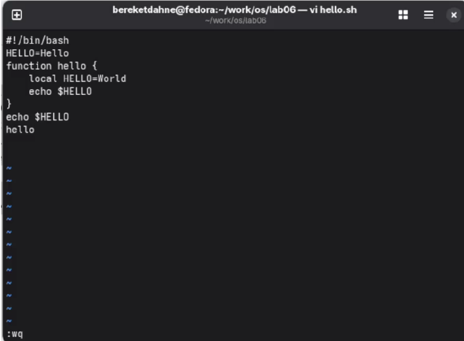

---
## Author
author:
  name: "Кебеде Берекет Дагне"
  email: 1032255864@rudn.ru
  affiliation:
    - name: Российский университет дружбы народов
      country: Российская Федерация
      postal-code: 117198
      city: Москва
      address: ул. Миклухо-Маклая, д. 6

## Title
title: "Лабораторная работа № 10"
subtitle: "Текстовой редактор vi"
date: "2026-10-02"
lang: ru
mainfont: "DejaVu Serif"
monofont: "DejaVu Sans Mono"
pdf-engine: xelatex
abstract: |
  В отчёте представлены результаты лабораторной работы № 10,
  посвящённой работе с текстовым редактором vi в Linux.
  Рассмотрены создание и редактирование файла hello.sh,
  основные режимы и команды редактора, а также ответы
  на контрольные вопросы.
keywords: [лабораторная работа, Linux, vi, текстовый редактор, shell]
---

# Введение

## Актуальность

Текстовые редакторы, работающие в терминале, позволяют создавать и изменять
файлы непосредственно в командной среде Linux. Освоение редактора `vi`
помогает выполнять операции редактирования без графического интерфейса.

## Цель работы

Познакомиться с операционной системой Linux. Получить практические навыки
работы с редактором `vi`, установленным по умолчанию практически во всех
дистрибутивах.

## Задачи

- Создать новый файл `hello.sh` с помощью редактора `vi`.
- Ввести текст скрипта и изменить права доступа к файлу.
- Открыть существующий файл и выполнить заданные исправления.
- Изучить командный режим, режим вставки и режим последней строки.
- Освоить основные команды перемещения, редактирования, записи и выхода.
- Ответить на 13 контрольных вопросов.

## Объект и предмет исследования

Объект исследования — текстовый редактор `vi` в операционной системе Linux.
Предмет исследования — режимы работы `vi`, команды редактирования и способы
создания и изменения текстового файла в терминале.

## Методы исследования

Практическая работа в терминале Linux с использованием редактора `vi`,
выполнение команд редактирования и анализ содержимого полученного файла.

## Схема выполнения работы

На @fig-flowchart представлена последовательность выполнения лабораторной
работы.

::: {#fig-flowchart}

```{mermaid}
%%| fig-width: 100%
graph TD
    A([Начало]) --> B[Создать рабочий каталог]
    B --> C[Открыть hello.sh в vi]
    C --> D[Ввести текст скрипта]
    D --> E[Сделать файл исполняемым]
    E --> F[Повторно открыть и отредактировать файл]
    F --> G[Сохранить итоговый текст]
    G --> H[Зафиксировать результаты и ответить на вопросы]
    H --> I([Конец])
```

Блок-схема выполнения лабораторной работы № 10

:::

# Теоретическая часть

Редактор `vi` использует несколько режимов работы. В **командном режиме**
вводятся команды перемещения и редактирования. **Режим вставки** предназначен
для непосредственного ввода текста. В **режиме последней строки** вводятся
команды записи файла, выхода из редактора и изменения его параметров.

В @tbl-vi-commands перечислены основные команды из исходного отчёта.

| Команда | Назначение |
|---------|------------|
| `i`, `a`, `o`, `O` | Вход в режим вставки разными способами |
| `Esc` | Возврат к командному режиму |
| `0` | Перемещение в начало строки |
| `$` | Перемещение в конец строки |
| `gg` | Перемещение в начало файла |
| `G` | Перемещение в конец файла |
| `nG` | Перемещение к строке с номером `n` |
| `x`, `dw`, `dd`, `d$` | Удаление символов, слов, строк и фрагментов |
| `cw`, `r` | Изменение слова и замена символа |
| `u` | Отмена последнего действия |
| `:w` | Запись изменений в файл |
| `:q` | Выход из редактора |
| `:wq` | Сохранение и выход |
| `:q!` | Выход без сохранения |
| `:set` | Настройка параметров редактора |

: Основные команды редактора vi {#tbl-vi-commands}

# Материалы и методы

Для практической работы использовались командная оболочка Linux, редактор
`vi` и команда `chmod`. Файл `hello.sh` создавался в каталоге
`~/work/os/lab06`. После ввода начального содержимого файл был открыт
повторно для исправления текста и выполнения действий редактирования.

# Выполнение лабораторной работы

## Задание 1. Создание нового файла с использованием vi

Сначала был создан рабочий каталог, выполнен переход в него и открыт новый
файл `hello.sh`:

```bash
mkdir -p ~/work/os/lab06
cd ~/work/os/lab06
vi hello.sh
```

В исходном отчёте приведён следующий первоначальный текст скрипта:

```bash
#!/bin/bash
HELL=Hello
function hello {
    LOCAL HELLO=World
    echo $HELLO
}
echo $HELLO
hello
```

После ввода текста выполнена команда изменения прав доступа:

```bash
chmod +x hello.sh
```

## Задание 2. Редактирование существующего файла

Для повторного открытия файла использована команда:

```bash
vi ~/work/os/lab06/hello.sh
```

В ходе редактирования выполнены действия, перечисленные в исходном отчёте:

- `HELL` заменено на `HELLO`.
- `LOCAL` заменено на `local`.
- Добавлена строка `echo $HELLO`.
- Удалена последняя строка.
- Последнее действие отменено командой `u`.

Итоговое содержимое файла, приведённое в отчёте:

```bash
#!/bin/bash
HELLO=Hello
function hello {
    local HELLO=World
    echo $HELLO
}
echo $HELLO
hello
```

# Результаты

В исходном отчёте результаты выполнения заданий сопровождаются тремя
скриншотами.

На @fig-vi-create показано создание файла `hello.sh`.

{#fig-vi-create width=4in}

На @fig-vi-edit показано редактирование файла.

{#fig-vi-edit width=4in}

На @fig-vi-final показан итоговый файл.

{#fig-vi-final width=4in}

# Обсуждение результатов

В ходе выполнения заданий были рассмотрены создание файла в редакторе
`vi`, изменение его содержимого и использование команды отмены.
В итоговом тексте скрипта исправлены имена `HELL` и `LOCAL`,
как указано в исходном отчёте.

## Ответы на контрольные вопросы

**1. Дайте краткую характеристику режимам работы редактора vi.**

- **Командный режим** — для ввода команд редактирования и навигации.
- **Режим вставки** — для ввода текста.
- **Режим последней строки** — для записи изменений и выхода.

**2. Как выйти из редактора, не сохраняя произведённые изменения?**

Набрать `:q!` и нажать Enter.

**3. Назовите и дайте краткую характеристику командам позиционирования.**

- `0` — в начало строки.
- `$` — в конец строки.
- `G` — в конец файла.
- `nG` — на строку с номером `n`.

**4. Что для редактора vi является словом?**

Слово — это последовательность символов, разделённая пробелами или
знаками препинания.

**5. Каким образом из любого места редактируемого файла перейти в начало (конец) файла?**

`gg` — в начало файла, `G` — в конец файла.

**6. Назовите и дайте краткую характеристику основным группам команд редактирования.**

- Вставка текста: `i`, `a`, `o`, `O`.
- Удаление текста: `x`, `dw`, `dd`, `d$`.
- Отмена: `u`.
- Замена: `cw`, `r`.

**7. Необходимо заполнить строку символами `\$`. Каковы ваши действия?**

Нажать `i`, ввести нужное количество символов `\$`, нажать `Esc`.

**8. Как отменить некорректное действие, связанное с процессом редактирования?**

Нажать `u` (undo).

**9. Назовите и дайте характеристику основным группам команд режима последней строки.**

- `:w` — записать.
- `:q` — выйти.
- `:wq` — записать и выйти.
- `:q!` — выйти без сохранения.
- `:set` — настройки.

**10. Как определить, не перемещая курсора, позицию, в которой заканчивается строка?**

В исходном отчёте указан вариант: нажать `$` — курсор переместится в
конец строки.

**11. Выполните анализ опций редактора vi.**

Опции задаются командой `:set`. Например: `set nu` — номера строк,
`set ic` — игнорировать регистр, `set list` — показать невидимые символы.

**12. Как определить режим работы редактора vi?**

В командном режиме внизу нет надписи. В режиме вставки внизу написано
`-- INSERT --`.

**13. Постройте граф взаимосвязи режимов работы редактора vi.**

В исходном отчёте приведена последовательность переходов:
командный режим → (`i`, `a`, `o`) → режим вставки → (`Esc`) →
командный режим → (`:`) → режим последней строки → (`Enter`) →
командный режим.

На @fig-vi-modes показана схема этих переходов.

::: {#fig-vi-modes}

```{mermaid}
%%| fig-width: 100%
graph LR
    A[Командный режим] -->|i, a, o| B[Режим вставки]
    B -->|Esc| A
    A -->|:| C[Режим последней строки]
    C -->|Enter| A
```

Граф взаимосвязи режимов редактора vi

:::

# Заключение

В ходе выполнения лабораторной работы № 10 я познакомился с редактором
`vi`. Я получил практические навыки работы с тремя режимами редактора:
командным, вставки и последней строки. Я научился создавать, редактировать,
сохранять файлы и выходить из редактора.

Таким образом, цель работы была полностью достигнута.

# Список литературы {.unnumbered}

::: {#refs}
:::

\appendix

# Приложение А. Краткая справка по режимам vi {.appendix}

- **Командный режим:** навигация, поиск и команды редактирования.
- **Режим вставки:** ввод нового текста.
- **Режим последней строки:** сохранение, выход и настройка редактора.
- **Переход в режим вставки:** `i`, `a`, `o`.
- **Возврат в командный режим:** `Esc`.
- **Открытие режима последней строки:** `:`.
