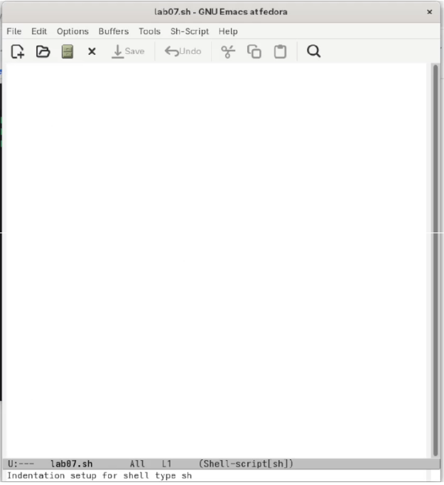

---
## Author
author:
  name: "Кебеде Берекет Дагне"
  email: "1032255864@rudn.ru"
  affiliation:
    - name: "Российский университет дружбы народов"
      country: "Российская Федерация"
      city: "Москва"
## Title
title: "Текстовой редактор Emacs"
subtitle: "Лабораторная работа № 11"
date: "2026-10-02"
lang: ru-RU
## Presentation output formats
format:
  revealjs:
    theme: serif
    slide-level: 2
    transition: none
  beamer:
    pdf-engine: xelatex
    slide-level: 2
    aspectratio: 169
    section-titles: true
    mainfont: "DejaVu Serif"
    monofont: "DejaVu Sans Mono"
---

# Информация

## Докладчик

:::::::::::::: {.columns align=center}
::: {.column width="70%"}

- **Кебеде Берекет Дагне**
- Российский университет дружбы народов (РУДН)
- [1032255864@rudn.ru](mailto:1032255864@rudn.ru)

:::
::: {.column width="30%"}

**Лабораторная работа № 11**

Текстовой редактор `Emacs`

:::
::::::::::::::

::: notes
- Представиться и назвать тему лабораторной работы.
:::

# Вводная часть

## Актуальность

- Emacs используется для работы с текстовыми файлами в Linux.
- Поддерживает буферы, окна и различные режимы редактирования.
- Позволяет искать и заменять текст, сохраняя результаты в файлах.

::: notes
- Кратко объяснить, зачем нужны текстовые редакторы в Linux.
:::

## Цель и задачи

**Цель:** получить практические навыки работы с редактором Emacs, установленным в Linux.

**Задачи:**

- Изучить основные понятия и команды Emacs.
- Создать и сохранить файл `lab07.sh`.
- Изучить работу с буферами и окнами.
- Использовать поиск и замену текста.

::: notes
- Озвучить цель и перечислить основные задачи.
:::

## Материалы и методы

- Операционная система Linux.
- Текстовый редактор `Emacs`.
- Файл скрипта `lab07.sh`.
- Клавиатурные сочетания для работы с файлами, буферами, окнами и поиском.

::: notes
- Работа выполнялась в Emacs с использованием клавиатурных команд.
:::

# Текстовой редактор Emacs

## Что такое Emacs?

- Мощный экранный редактор текста.
- Использует язык Elisp.
- Имеет буферы, фреймы и окна.
- Поддерживает множество режимов.

::: notes
- Описать основные возможности Emacs из исходной презентации.
:::

## Основные термины

- **Буфер** — объект, содержащий текст.
- **Фрейм** — окно в обычном понимании.
- **Окно** — прямоугольная область фрейма.
- **Минибуфер** — для ввода команд.
- **Точка вставки** — место ввода текста.

::: notes
- Объяснить различие между буфером, фреймом и окном Emacs.
:::

## Основные команды — часть 1

| Команда | Действие |
|---------|----------|
| `C-x C-f` | Открыть файл |
| `C-x C-s` | Сохранить |
| `C-x C-c` | Выйти |
| `C-x C-b` | Список буферов |
| `C-x b` | Переключить буфер |

::: notes
- Пояснить, что обозначение C означает клавишу Ctrl.
- Продемонстрировать команды открытия и сохранения файла.
:::

## Основные команды — часть 2

| Команда | Действие |
|---------|----------|
| `C-x 0` | Закрыть окно |
| `C-x 2` | Разделить горизонтально |
| `C-x 3` | Разделить вертикально |
| `C-s` | Поиск вперёд |
| `M-%` | Поиск и замена |

::: notes
- Пояснить, что обозначение M обычно соответствует Meta или Alt.
- Рассказать об управлении окнами и поиске текста.
:::

# Практическая часть

## Что было сделано

1. Открыт редактор Emacs.
2. Создан файл `lab07.sh`.
3. Введён текст скрипта.
4. Файл сохранён.
5. Изучены буферы и окна.
6. Использован поиск и замена.

::: notes
- Перечислить этапы практической работы из исходной презентации.
:::

## Создание файла `lab07.sh`

- Запуск редактора: `emacs`.
- Открытие или создание файла: `C-x C-f`.
- Сохранение файла: `C-x C-s`.

```bash
#!/bin/bash
HELLO=Hello
function hello {
    local HELLO=World
    echo $HELLO
}
echo $HELLO
hello
```

::: notes
- Текст скрипта приведён в отчёте по лабораторной работе № 11.
- Пояснить, как файл открывался и сохранялся в Emacs.
:::

# Иллюстрации выполнения работы

## Окно Emacs с файлом `lab07.sh`

{width=50%}

::: notes
- Показать редактор Emacs и созданный файл скрипта.
:::

## Разделение окна Emacs

{width=50%}

::: notes
- Объяснить работу с несколькими окнами редактора.
:::

## Режим поиска

{width=50%}

::: notes
- Показать режим поиска текста и упомянуть поиск с заменой.
:::

# Результаты

## Полученные результаты

- Создан и сохранён файл `lab07.sh`.
- Изучены буферы и окна редактора Emacs.
- Освоены основные сочетания клавиш для работы с файлами.
- Выполнены поиск и замена текста.

::: notes
- Кратко подвести итог выполненных практических действий.
:::

# Заключение

## Выводы

Получены практические навыки работы с редактором Emacs. Изучены буферы, окна, поиск и замена текста.

::: notes
- Повторить вывод из исходной презентации.
:::

## Спасибо за внимание!

::: notes
- Поблагодарить аудиторию и предложить задать вопросы.
:::
