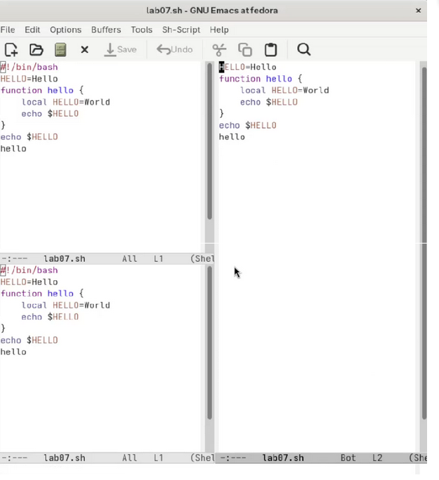
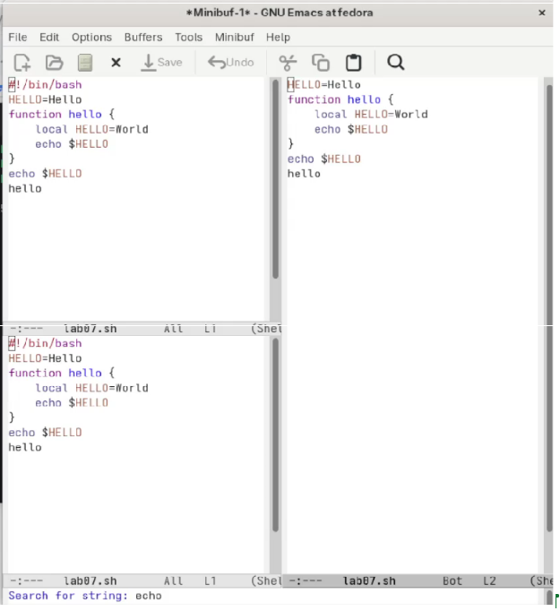

---
title: "Лабораторная работа № 11"
author:
  name: "Кебеде Берекет Дагне"
  email: "1032255864@rudn.ru"
date: "2026-10-02"
lang: ru
mainfont: "DejaVu Serif"
monofont: "DejaVu Sans Mono"
pdf-engine: xelatex
---

# Лабораторная работа № 11
## Текстовой редактор emacs

---

### Цель работы
Познакомиться с операционной системой Linux. Получить практические навыки работы с редактором Emacs.

---

### Выполнение работы

#### 1. Запуск Emacs
```bash
emacs
```

#### 2. Создание файла lab07.sh
Создан файл с помощью `C-x C-f`.

Текст скрипта:
```bash
#!/bin/bash
HELLO=Hello
function hello {
    local HELLO=World
    echo $HELLO
}
echo $HELLO
hello
```

#### 3. Сохранение файла
Сохранено с помощью `C-x C-s`.

#### 4. Редактирование текста
- Выделение области текста (`C-space`)
- Копирование (`M-w`)
- Вставка (`C-y`)
- Вырезание (`C-w`)
- Отмена (`C-/`)

#### 5. Перемещение курсора
- `C-p` — вверх
- `C-n` — вниз
- `C-f` — вперёд
- `C-b` — назад
- `C-a` — в начало строки
- `C-e` — в конец строки
- `M-<` — в начало файла
- `M->` — в конец файла

#### 6. Работа с буферами
- `C-x C-b` — список буферов
- `C-x b` — переключение буфера
- `C-x 0` — закрытие окна

#### 7. Управление окнами
- `C-x 3` — разделить вертикально
- `C-x 2` — разделить горизонтально
- `C-x 1` — закрыть другие окна

#### 8. Режим поиска
- `C-s` — поиск вперёд
- `C-r` — поиск назад
- `M-%` — поиск и замена
- `M-s o` — другой режим поиска
- `C-g` — выход из поиска

---


### Результаты работы

**Скриншот 1:** Окно Emacs с файлом lab07.sh

{ width=4in }

\newpage

**Скриншот 2:** Разделение окна на несколько частей

{ width=4in }

\newpage

**Скриншот 3:** Режим поиска

{ width=4in }

---

### Ответы на контрольные вопросы

**1. Дайте краткую характеристику режимам работы редактора emacs.**
Emacs не имеет фиксированных режимов, как vi. Вместо этого есть основные режимы (Fundamental, Text, Lisp, C и др.) и второстепенные режимы, которые включаются в буфере.

**2. Как выйти из редактора, не сохраняя произведённые изменения?**
Нажать `C-x C-c` и выбрать "No" при запросе о сохранении.

**3. Назовите и дайте краткую характеристику командам позиционирования.**
- `C-p` — вверх
- `C-n` — вниз
- `C-f` — вперёд
- `C-b` — назад
- `C-a` — в начало строки
- `C-e` — в конец строки
- `M-<` — в начало файла
- `M->` — в конец файла

**4. Что для редактора emacs является словом?**
Слово — это последовательность символов, разделённая пробелами или знаками препинания.

**5. Каким образом из любого места редактируемого файла перейти в начало (конец) файла?**
`M-<` — в начало файла, `M->` — в конец файла.

**6. Назовите и дайте краткую характеристику основным группам команд редактирования.**
- Удаление: `C-d`, `M-d`, `C-k`
- Вставка: `C-q`, `M-q`
- Выделение: `C-space`
- Копирование: `M-w`
- Вставка из буфера: `C-y`
- Вырезание: `C-w`
- Отмена: `C-/`

**7. Необходимо заполнить строку символами $. Каковы ваши действия?**
Нажать `C-q` для вставки символа `$` (quoted insert).

**8. Как отменить некорректное действие, связанное с процессом редактирования?**
Нажать `C-/` (undo).

**9. Назовите и дайте характеристику основным группам команд режима последней строки.**
В Emacs нет отдельного режима последней строки. Команды вводятся через `M-x` (по имени) или через минибуфер.

**10. Как определить, не перемещая курсора, позицию, в которой заканчивается строка?**
Нажать `C-e` — курсор переместится в конец строки.

**11. Выполните анализ опций редактора emacs.**
Опции настраиваются через меню Options или через файл `.emacs`. Можно включить номера строк, подсветку синтаксиса, автодополнение.

**12. Как определить режим работы редактора emacs?**
Режим отображается в строке состояния внизу экрана (например, `Fundamental`, `Text`, `Shell-script`).

**13. Постройте граф взаимосвязи режимов работы редактора emacs.**
Основные режимы: Fundamental, Text, Lisp, C, Shell-script. Второстепенные режимы включаются поверх основных. Переключение через `M-x` или автоматически по расширению файла.

---

### Выводы

В ходе выполнения лабораторной работы № 11 я познакомился с редактором Emacs. Я получил практические навыки работы с буферами, окнами, поиском и заменой текста. Я научился создавать, редактировать и сохранять файлы.

Таким образом, цель работы была полностью достигнута.
```
