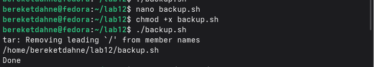
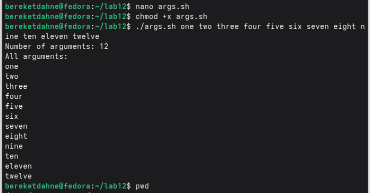
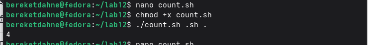

---
## Author
author:
  name: "Кебеде Берекет Дагне"
  email: "1032255864@rudn.ru"
  affiliation:
    - name: "Российский университет дружбы народов"
      country: "Российская Федерация"
      city: "Москва"
## Title
title: "Программирование в командном процессоре ОС UNIX"
subtitle: "Лабораторная работа № 12"
date: "2026-10-03"
lang: ru-RU
## Presentation output formats
format:
  revealjs:
    theme: serif
    slide-level: 2
    transition: none
  beamer:
    pdf-engine: xelatex
    slide-level: 2
    aspectratio: 169
    section-titles: true
    mainfont: "DejaVu Serif"
    monofont: "DejaVu Sans Mono"
---

# Информация

## Докладчик

:::::::::::::: {.columns align=center}
::: {.column width="70%"}

- **Кебеде Берекет Дагне**
- Российский университет дружбы народов (РУДН)
- [1032255864@rudn.ru](mailto:1032255864@rudn.ru)

:::
::: {.column width="30%"}

**Лабораторная работа № 12**

Программирование в командном процессоре ОС UNIX

:::
::::::::::::::

::: notes
- Представиться и объявить тему лабораторной работы.
:::

# Вводная часть

## Актуальность

- Командные оболочки UNIX позволяют не только выполнять команды, но и писать сценарии.
- Bash-скрипты автоматизируют повторяющиеся операции.
- В работе рассматриваются четыре примера командных файлов.

::: notes
- Кратко объяснить, для чего нужны сценарии командной оболочки.
:::

## Цель и задачи

**Цель:** изучить основы программирования в командном процессоре ОС UNIX и научиться создавать командные файлы.

**Задачи:**

- Познакомиться с оболочками и синтаксисом сценариев.
- Изучить переменные, операторы и управляющие конструкции.
- Создать четыре сценария Bash.

::: notes
- Сформулировать цель из исходной презентации.
- Перечислить четыре сценария в практической части.
:::

## Материалы и методы

- Операционная система Fedora Linux.
- Командная оболочка `bash`.
- Текстовый редактор `nano`.
- Командные файлы `backup.sh`, `args.sh`, `myls.sh`, `count.sh`.

::: notes
- Перечислить программное обеспечение и файлы из отчёта.
:::

# Программирование в UNIX

## Командные оболочки

| Оболочка | Название |
|----------|----------|
| `sh` | Bourne shell |
| `csh` | C shell |
| `ksh` | Korn shell |
| `bash` | Bourne Again Shell |

::: notes
- Назвать четыре оболочки из исходной презентации.
- На практике в лабораторной работе используется Bash.
:::

## Переменные и операторы

- **Переменная:** `name=value`.
- **Арифметические операции:** `+`, `-`, `*`, `/`, `%`.
- **Метасимволы:** `*`, `?`, `[ ]`.
- **Экранирование:** обратная косая черта `\` и кавычки.

::: notes
- Привести пример присваивания значения переменной.
:::

## Управляющие конструкции

- `if` — условие.
- `for` — цикл по списку.
- `while` — цикл с условием.
- `case` — выбор варианта.
- `break` и `continue` — управление ходом цикла.

::: notes
- Объяснить, зачем необходимы условные операторы и циклы.
:::

# Практическая часть

## Что было сделано

1. Скрипт резервного копирования `backup.sh`.
2. Скрипт обработки аргументов `args.sh`.
3. Аналог команды `ls` — `myls.sh`.
4. Подсчёт файлов по расширению — `count.sh`.

::: notes
- Кратко перечислить задания практической части.
:::

## Скрипт `backup.sh`

```bash
#!/bin/bash
mkdir -p ~/backup
tar -czvf ~/backup/backup.tar.gz ~/lab12/backup.sh
echo "Done"
```

Создаёт архив в каталоге `~/backup/`.

::: notes
- Пояснить назначение mkdir и tar.
- Этот код приведён в исходном отчёте.
:::

## Скрипт `args.sh`

```bash
#!/bin/bash
echo "Number of arguments: $#"
for arg in "$@"
do
    echo "$arg"
done
```

Выводит количество аргументов и каждый аргумент отдельно.

::: notes
- Объяснить значения `$#` и `"$@"`.
:::

## Скрипт `myls.sh`

```bash
#!/bin/bash
DIR="${1:-.}"
for file in "$DIR"/*
do
    if [ -d "$file" ]; then
        echo "[DIR] $file"
    elif [ -x "$file" ]; then
        echo "[EXEC] $file"
    else
        echo "[FILE] $file"
    fi
done
```

::: notes
- Объяснить, что скрипт перебирает элементы каталога и классифицирует их по условиям.
:::

## Скрипт `count.sh`

```bash
#!/bin/bash
cd $2
ls *$1 | wc -l
```

Использует два позиционных аргумента для выбора каталога и подсчёта строк вывода `ls`.

::: notes
- Кратко объяснить, как используются $1 и $2.
- Код перенесён из исходного отчёта без изменения логики.
:::

# Иллюстрации выполнения работы

## Резервное копирование — `backup.sh`

{width=75%}

::: notes
- Показать скриншот работы первого сценария.
:::

## Обработка аргументов — `args.sh`

{width=75%}

::: notes
- Показать количество и вывод аргументов на скриншоте.
:::

## Аналог `ls` — `myls.sh`

{width=75%}

::: notes
- Пояснить обозначения DIR, EXEC и FILE.
:::

## Подсчёт файлов — `count.sh`

{width=75%}

::: notes
- Показать результат сценария подсчёта файлов.
:::

# Результаты

## Полученные результаты

- Созданы четыре командных файла на Bash.
- Выполнено резервное копирование.
- Изучена обработка аргументов командной строки.
- Отработано использование условий и циклов в сценариях.

::: notes
- Подвести итоги выполненной практической работы.
:::

# Заключение

## Выводы

Изучены основы программирования в Bash. Созданы четыре командных файла: `backup.sh`, `args.sh`, `myls.sh` и `count.sh`.

::: notes
- Повторить вывод из исходной презентации.
:::

## Спасибо за внимание!

::: notes
- Поблагодарить аудиторию и предложить задать вопросы.
:::
