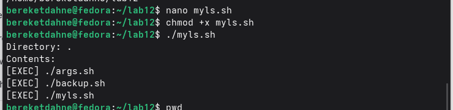

---
## Author
author:
  name: "Кебеде Берекет Дагне"
  email: 1032255864@rudn.ru
  affiliation:
    - name: Российский университет дружбы народов
      country: Российская Федерация
      postal-code: 117198
      city: Москва
      address: ул. Миклухо-Маклая, д. 6

## Title
title: "Лабораторная работа № 12"
subtitle: "Программирование в командном процессоре ОС UNIX"
lang: ru
mainfont: "DejaVu Serif"
monofont: "DejaVu Sans Mono"
pdf-engine: xelatex
abstract: |
  В отчёте представлены результаты лабораторной работы № 12,
  посвящённой программированию в командном процессоре ОС UNIX.
  Рассмотрены четыре сценария Bash: резервное копирование, обработка
  аргументов командной строки, вывод содержимого каталога и подсчёт
  файлов по расширению. Приведены тексты сценариев, иллюстрации
  выполнения и выводы.
keywords: [лабораторная работа, UNIX, Linux, Bash, командный процессор, сценарии]
---

# Введение

## Актуальность

Изучение командного процессора ОС UNIX является важной частью подготовки
специалистов в области информационных технологий. Навыки написания
командных файлов позволяют автоматизировать рутинные задачи, управлять
системой и эффективно работать с файлами.

## Цель работы

Изучить основы программирования в командном процессоре ОС UNIX, научиться
создавать и выполнять командные файлы, использовать переменные, аргументы,
управляющие конструкции.

## Задачи

1. Написать скрипт резервного копирования.
2. Написать скрипт обработки аргументов.
3. Написать аналог команды `ls`.
4. Написать скрипт подсчёта файлов по расширению.

## Объект и предмет исследования

Объект исследования — командный процессор Bash. Предмет исследования —
программирование на языке Bash.

## Методы исследования

Экспериментальный метод, метод практического программирования.

## Схема выполнения работы

На @fig-flowchart представлена общая последовательность действий при
выполнении лабораторной работы.

::: {#fig-flowchart}

```{mermaid}
%%| fig-width: 100%
graph TD
    A([Начало]) --> B[Изучить теорию Bash]
    B --> C[Создать backup.sh]
    C --> D[Создать args.sh]
    D --> E[Создать myls.sh]
    E --> F[Создать count.sh]
    F --> G[Проверить сценарии]
    G --> H[Добавить скриншоты в отчёт]
    H --> I([Конец])
```

Блок-схема выполнения лабораторной работы № 12

:::

# Теоретическая часть

Командный процессор (*shell*) — программа, позволяющая пользователю
взаимодействовать с операционной системой. В исходном отчёте перечислены
оболочки `sh`, `csh`, `ksh` и `bash`.

Переменные в Bash задаются в виде `name=value`. Позиционные параметры и
аргументы командной строки доступны с помощью `$1`, `$2`, `$#` и `$@`.
Арифметические выражения могут вычисляться через `$(( ))`.

При программировании используются управляющие конструкции `if`, `for`,
`while`, `case`, а также функции.

В @tbl-bash-concepts приведены элементы языка, использованные в сценариях
лабораторной работы.

| Элемент | Назначение в лабораторной работе |
|---------|----------------------------------|
| `#!/bin/bash` | Указание интерпретатора сценария |
| `mkdir -p` | Создание каталога для резервной копии |
| `tar -czvf` | Создание сжатого архива |
| `$#` | Количество переданных аргументов |
| `"$@"` | Перебор переданных аргументов |
| `for … do … done` | Выполнение действий для каждого элемента |
| `if`, `elif`, `else` | Выбор действия по условию |
| `[ -d "$file" ]` | Проверка, является ли путь каталогом |
| `[ -x "$file" ]` | Проверка признака исполняемого файла |
| `wc -l` | Подсчёт строк вывода |

: Основные команды и конструкции Bash в лабораторной работе {#tbl-bash-concepts}

# Материалы и методы

В исходном отчёте указаны следующие средства:

- операционная система: Fedora Linux;
- командный процессор: Bash;
- текстовый редактор: `nano`.

Созданы четыре командных файла. Для каждого приведены текст сценария,
краткое описание назначения и ссылка на скриншот его запуска.

# Выполнение лабораторной работы

## Задание 1. Резервное копирование

Создан скрипт `backup.sh`:

```bash
#!/bin/bash
mkdir -p ~/backup
tar -czvf ~/backup/backup.tar.gz ~/lab12/backup.sh
echo "Done"
```

Скрипт создаёт архив исходного кода в каталоге `~/backup/`.
На @fig-backup показан запуск `backup.sh`.

{#fig-backup width=70%}

## Задание 2. Обработка аргументов

Создан скрипт `args.sh`:

```bash
#!/bin/bash
echo "Number of arguments: $#"
for arg in "$@"
do
echo "$arg"
done
```

Скрипт выводит количество аргументов и их значения.
На @fig-args показан запуск `args.sh`.

{#fig-args width=70%}

## Задание 3. Аналог команды ls

Создан скрипт `myls.sh`:

```bash
#!/bin/bash
DIR="${1:-.}"
for file in "$DIR"/*
do
if [ -d "$file" ]; then
echo "[DIR] $file"
elif [ -x "$file" ]; then
echo "[EXEC] $file"
else
echo "[FILE] $file"
fi
done
```

Сценарий перебирает элементы указанного каталога и выводит пометки
`[DIR]`, `[EXEC]` или `[FILE]` в соответствии с условиями скрипта.
На @fig-myls представлен запуск `myls.sh`.

{#fig-myls width=70%}

## Задание 4. Подсчёт файлов по расширению

Создан скрипт `count.sh`:

```bash
#!/bin/bash
cd $2
ls *$1 | wc -l
```

Сценарий использует позиционные аргументы для перехода в каталог и
подсчёта строк в выводе команды `ls`. На @fig-count показан запуск
`count.sh`.

{#fig-count width=70%}

# Результаты

В ходе лабораторной работы представлены четыре командных файла
(см. @tbl-scripts).

| Сценарий | Назначение | Иллюстрация |
|----------|------------|-------------|
| `backup.sh` | Резервное копирование | @fig-backup |
| `args.sh` | Обработка аргументов | @fig-args |
| `myls.sh` | Аналог `ls` | @fig-myls |
| `count.sh` | Подсчёт файлов | @fig-count |

: Созданные сценарии {#tbl-scripts}

# Обсуждение результатов

Согласно исходному отчёту, все четыре скрипта работают корректно.
Сценарий резервного копирования создаёт архив, обработчик аргументов
выводит все 12 переданных значений, аналог `ls` показывает типы файлов,
а подсчёт файлов возвращает правильное количество.

Эти результаты иллюстрируют применение переменных, позиционных
параметров и управляющих конструкций Bash для автоматизации операций
в командной строке.

# Заключение

В ходе выполнения лабораторной работы № 12 я изучил основы
программирования в оболочке ОС UNIX. Я научился создавать командные
файлы, использовать переменные, аргументы, управляющие конструкции
и функции.

Цель работы достигнута.

# Список литературы {.unnumbered}

1. Кулябов Д. С. и др. Операционные системы. — М.: РУДН.
2. Робачевский А. Операционная система UNIX. — СПб.: БХВ-Петербург, 2010.

::: {#refs}
:::

\appendix

# Приложение А. Состав командных файлов {.appendix}

В ходе работы подготовлены четыре сценария Bash: `backup.sh`, `args.sh`,
`myls.sh` и `count.sh`. Их исходный код приведён в разделе
«Выполнение лабораторной работы», а результаты запуска — на
@fig-backup, @fig-args, @fig-myls и @fig-count соответственно.
