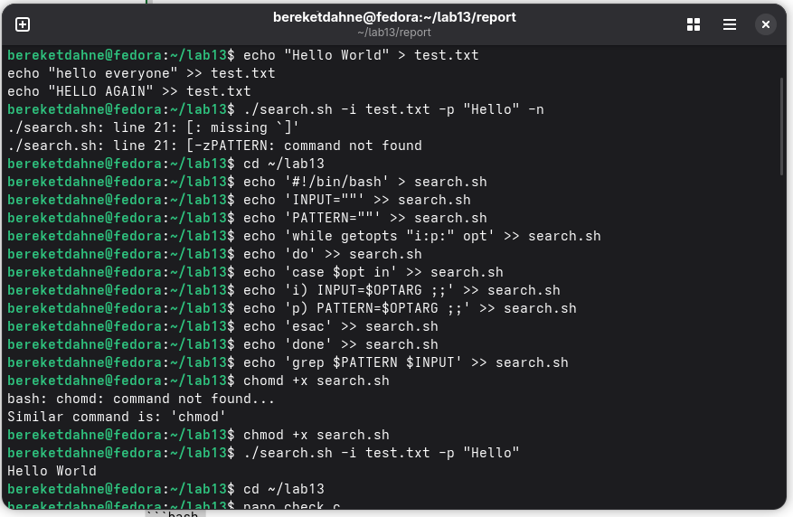
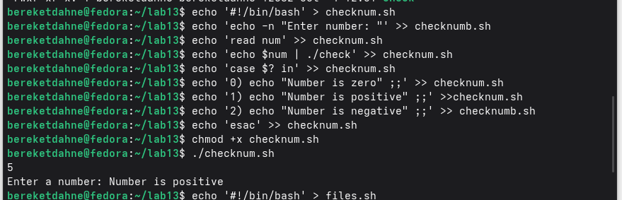
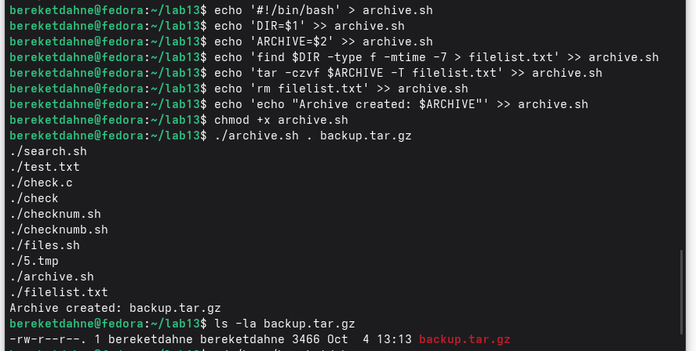

---
## Author
author:
  name: Bereket Dagne
  degrees: DSc
  orcid: 0000-0002-0877-7063
  email: kulyabov-ds@rudn.ru
  affiliation:
    - name: Российский университет дружбы народов
      country: Российская Федерация
      postal-code: 117198
      city: Москва
      address: ул. Миклухо-Маклая, д. 6

## Title
title: "Лабораторная работа № 13"
subtitle: "Программирование в командном процессоре ОС UNIX. Ветвления и циклы"
license: "CC BY"
abstract: |
  В отчёте представлены результаты выполнения лабораторной работы № 13.

  Рассмотрены использование getopts и grep, завершение программы на Си с помощью exit(), создание и удаление файлов, а также архивация файлов с помощью tar и find.
keywords: [лабораторная работа, UNIX, bash, ветвления, циклы]
---

# Введение

## Актуальность

Командная оболочка ОС UNIX позволяет автоматизировать работу с файлами, обрабатывать аргументы командной строки и выполнять последовательности команд с использованием условий и циклов.

## Цель работы

Изучить основы программирования в оболочке ОС UNIX. Научиться писать более сложные командные файлы с использованием логических управляющих конструкций и циклов.

## Задачи

- Создать скрипт с использованием `getopts` и `grep`.
- Написать программу на Си, которая возвращает код завершения в зависимости от введённого числа, и обработать этот код в Bash.
- Создать и удалить заданное количество файлов.
- Архивировать файлы, изменённые за последние семь дней, с помощью `find` и `tar`.

## Объект и предмет исследования

Объект исследования — программирование в командном процессоре ОС UNIX. Предмет исследования — использование аргументов командной строки, кодов завершения, ветвлений, циклов и команд обработки файлов.

## Методы исследования

Использовались написание и запуск Bash-скриптов, компиляция и запуск программы на Си, а также проверка результатов выполнения команд.

## Схема выполнения работы

На рис. -@fig-flowchart представлена общая последовательность действий при выполнении работы.

::: {#fig-flowchart}

```{mermaid}
%%| fig-width: 100%
graph TD
    A@{ shape: circle, label: "Начало" } --> B[Создать и запустить скрипт]
    B --> C[Проверить результат выполнения]
    C --> D[Подтвердить результат скриншотом]
    D --> E[Занести результат в отчёт]
    E --> F[Сделать выводы]
    F --> G@{ shape: dbl-circ, label: "Конец" }
```

Блок-схема выполнения лабораторной работы

:::

# Теоретическая часть

В работе использовались средства командной оболочки Bash для обработки аргументов, управления ходом выполнения программы и работы с файлами.

- `getopts` разбирает параметры командной строки и их аргументы.
- `grep` ищет строки, соответствующие заданному шаблону.
- `exit()` завершает программу на Си с указанным кодом завершения; в Bash этот код доступен через `$?`.
- `if` и `case` позволяют выбирать действия в зависимости от условия или кода завершения.
- `for` и `seq` используются для повторения команд заданное число раз.
- `find` ищет файлы по заданным критериям, а `tar` создаёт архив.

# Материалы и методы

Выполнение работы проводилось в ОС UNIX/Linux с использованием Bash и компилятора Си. Были подготовлены скрипты `search.sh`, `checknum.sh`, `files.sh` и `archive.sh`, а также программа `check.c`.

# Выполнение лабораторной работы

## Задание 1. Скрипт с getopts и grep

Скрипт `search.sh`:

```bash
#!/bin/bash
INPUT=""
PATTERN=""
while getopts "i:p:" opt
do
case $opt in
i) INPUT=$OPTARG ;;
p) PATTERN=$OPTARG ;;
esac
done
grep $PATTERN $INPUT
```

Результат: найдена строка `Hello World` в файле `test.txt`.

## Задание 2. Программа на Си с exit()

Программа `check.c`:

```c
#include <stdio.h>
#include <stdlib.h>

int main() {
    int num;
    printf("Enter a number: ");
    scanf("%d", &num);

    if (num > 0) {
        exit(1);
    } else if (num < 0) {
        exit(2);
    } else {
        exit(0);
    }
}
```

Скрипт `checknum.sh`:

```bash
#!/bin/bash
echo -n "Enter number: "
read num
echo $num | ./check
case $? in
0) echo "Number is zero" ;;
1) echo "Number is positive" ;;
2) echo "Number is negative" ;;
esac
```

Результат: при вводе `5` выведено `Number is positive`.

## Задание 3. Создание и удаление N файлов

Скрипт `files.sh`:

```bash
#!/bin/bash
N=$1
ACTION=$2
if [ "$ACTION" == "delete" ]; then
for i in $(seq 1 $N); do rm -f $i.tmp; done
echo "Deleted $N files"
else
for i in $(seq 1 $N); do touch $i.tmp; done
echo "Created $N files"
fi
```

Результат: создано 5 файлов (`5.tmp` и другие).

## Задание 4. Архивация файлов с tar и find

Скрипт `archive.sh`:

```bash
#!/bin/bash
DIR=$1
ARCHIVE=$2
find $DIR -type f -mtime -7 > filelist.txt
tar -czvf $ARCHIVE -T filelist.txt
rm filelist.txt
echo "Archive created: $ARCHIVE"
```

Результат: создан архив `backup.tar.gz` размером 3466 байт.

# Результаты

Результаты выполнения заданий подтверждались скриншотами:

**Скриншот 1:** Запуск скрипта `search.sh`.

{#fig-001 width=70%}

**Скриншот 2:** Запуск `checknum.sh`.

{#fig-002 width=70%}

**Скриншот 3:** Создание файлов.

{#fig-003 width=70%}

**Скриншот 4:** Архивация файлов.

{#fig-004 width=70%}

# Обсуждение результатов

Скрипт `search.sh` нашёл строку `Hello World` в `test.txt`. Программа `check.c` возвращает разные коды завершения для положительного, отрицательного и нулевого числа, а `checknum.sh` интерпретирует эти коды. Скрипт `files.sh` позволяет создавать или удалять указанное количество файлов. Скрипт `archive.sh` выбирает файлы, изменённые за последние семь дней, и сохраняет их в архив `backup.tar.gz`.

# Заключение

- Изучено использование `getopts` и `grep` для обработки аргументов и поиска текста.
- Реализована программа на Си с кодами завершения и Bash-скрипт для интерпретации этих кодов.
- Создан скрипт для создания и удаления заданного количества файлов.
- Реализована архивация недавно изменённых файлов с помощью `find` и `tar`.
- Цель лабораторной работы достигнута.

# Список литературы {.unnumbered}

::: {#refs}
:::

\appendix

# Что выносится в приложения {.appendix}

В приложение могут быть вынесены листинги программ `search.sh`, `check.c`, `checknum.sh`, `files.sh` и `archive.sh`.
