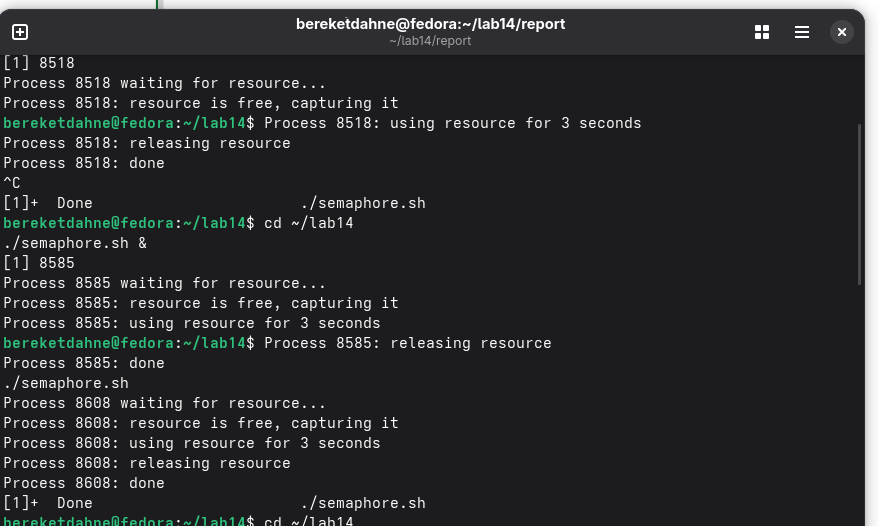
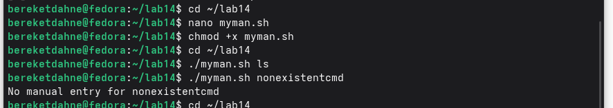
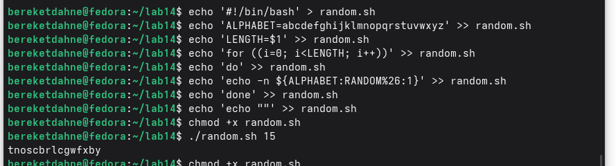

---
## Author
author:
  name: "Кебеде Берекет Дагне"
  email: "1032255864@rudn.ru"
  affiliation:
    - name: "Российский университет дружбы народов"
      country: "Российская Федерация"
      city: "Москва"
## Title
title: "Программирование в командном процессоре ОС UNIX. Семафоры, man, случайные последовательности"
subtitle: "Лабораторная работа № 14"
date: "2026-10-04"
lang: ru-RU
## Presentation output formats
format:
  revealjs:
    theme: serif
    slide-level: 2
    transition: none
  beamer:
    pdf-engine: xelatex
    slide-level: 2
    aspectratio: 169
    section-titles: true
    mainfont: "DejaVu Serif"
    monofont: "DejaVu Sans Mono"
---

# Информация

## Докладчик

:::::::::::::: {.columns align=center}
::: {.column width="70%"}

- **Кебеде Берекет Дагне**
- Российский университет дружбы народов (РУДН)
- [1032255864@rudn.ru](mailto:1032255864@rudn.ru)

:::
::: {.column width="30%"}

**Лабораторная работа № 14**

Программирование в командном процессоре ОС UNIX. Семафоры, man, случайные последовательности

:::
::::::::::::::

::: notes
- Представиться, назвать номер и тему лабораторной работы.
:::

# Вводная часть

## Актуальность

- Сценарии командной оболочки позволяют автоматизировать действия в UNIX.
- При совместной работе процессов требуется согласовывать доступ к ресурсу.
- Скрипты также позволяют работать со справкой и генерировать последовательности символов.

::: notes
- Объяснить связь трёх заданий с программированием в командной оболочке.
:::

## Цель и задачи

**Цель:** изучить основы программирования в оболочке ОС UNIX и научиться писать более сложные командные файлы с использованием логических управляющих конструкций и циклов.

**Задачи:**

1. Рассмотреть взаимодействие процессов с помощью файла-блокировки.
2. Реализовать получение справки `man` с помощью скрипта.
3. Сгенерировать последовательность случайных букв.

::: notes
- Цель сформулирована по исходной презентации.
- Перечислить три задания практической части.
:::

## Материалы и методы

- Командная оболочка Bash.
- Файл-блокировка `resource.lock`.
- Каталог `/usr/share/man/man1` и архивы `.1.gz`.
- Команда `zcat` и переменная `$RANDOM`.

::: notes
- Перечислить инструменты, упомянутые в исходном Markdown.
:::

# Теоретическая часть

## Что было изучено

- Механизм семафоров в Bash.
- Реализация команды `man` с помощью скрипта.
- Генерация случайных букв с использованием `$RANDOM`.

::: notes
- Обозначить три темы лабораторной работы.
:::

## Семафоры и файл-блокировка

- Для обозначения занятого ресурса используется файл `resource.lock`.
- Процесс ожидает освобождения ресурса.
- После получения доступа ресурс захватывается, затем освобождается.
- Рассматривается взаимодействие двух и более процессов.

::: notes
- Пояснить последовательность: ожидание, захват, освобождение.
- В исходной презентации описан механизм через файл-блокировку, без исходного кода скрипта.
:::

## Получение справки через `man`

- Страницы справки рассматриваются в каталоге `/usr/share/man/man1`.
- Используются архивы с расширением `.1.gz`.
- Команда `zcat` позволяет вывести распакованное содержимое.
- При отсутствии страницы выводится соответствующее сообщение.

::: notes
- Объяснить, для чего в задании используются архивы .1.gz и команда zcat.
:::

## Случайные последовательности

- Переменная `$RANDOM` возвращает целое число от **0 до 32767**.
- Для индекса буквы используется выражение `RANDOM % 26`.
- Индексы применяются для формирования последовательности случайных букв.

::: notes
- Объяснить, что операция остатка от деления даёт индекс от 0 до 25.
:::

# Практическая часть

## Что было сделано

1. Создан скрипт `semaphore.sh`.
2. Создан скрипт `myman.sh`.
3. Создан скрипт `random.sh`.

::: notes
- Назвать все три созданных файла.
:::

## Задание 1 — `semaphore.sh`

- Файл-блокировка: `resource.lock`.
- Ожидание, пока ресурс освободится.
- Захват и освобождение ресурса.
- Работа с двумя и более процессами.

::: notes
- Продемонстрировать результат выполнения скрипта, если есть соответствующий скриншот.
:::

## Задание 2 — `myman.sh`

- Поиск страницы в `/usr/share/man/man1`.
- Работа с файлами `.1.gz`.
- Просмотр текста справки с помощью `zcat`.
- Сообщение, если справка отсутствует.

::: notes
- Пояснить, как скрипт предназначен выводить справку.
:::

## Задание 3 — `random.sh`

- Получение чисел через `$RANDOM`.
- Определение индекса как `RANDOM % 26`.
- Построение последовательности случайных букв.

::: notes
- Показать принцип получения индексов букв.
:::

# Иллюстрации выполнения работы

## Семафоры — `semaphore.sh`

{width=50%}

::: notes
- Скриншот предполагается в файле image/result1.png; проверить фактическое имя файла.
:::

## Команда `man` — `myman.sh`

{width=75%}

::: notes
- Скриншот предполагается в файле image/result2.png; проверить фактическое имя файла.
:::

## Случайные буквы — `random.sh`

{width=75%}

::: notes
- Скриншот предполагается в файле image/result3.png; проверить фактическое имя файла.
:::

# Результаты

## Полученные результаты

- Изучена работа с файлом-блокировкой для согласования доступа к ресурсу.
- Рассмотрено получение справки из архивированных страниц `man`.
- Изучена генерация случайных букв с помощью `$RANDOM`.
- Созданы скрипты `semaphore.sh`, `myman.sh`, `random.sh`.

::: notes
- Кратко сопоставить каждый сценарий с отдельным заданием.
:::

# Заключение

## Выводы

Изучены семафоры, реализация `man` и генерация случайных букв. Цель работы достигнута.

::: notes
- Подвести итог лабораторной работы.
:::

## Спасибо за внимание!

::: notes
- Поблагодарить аудиторию и предложить задать вопросы.
:::
